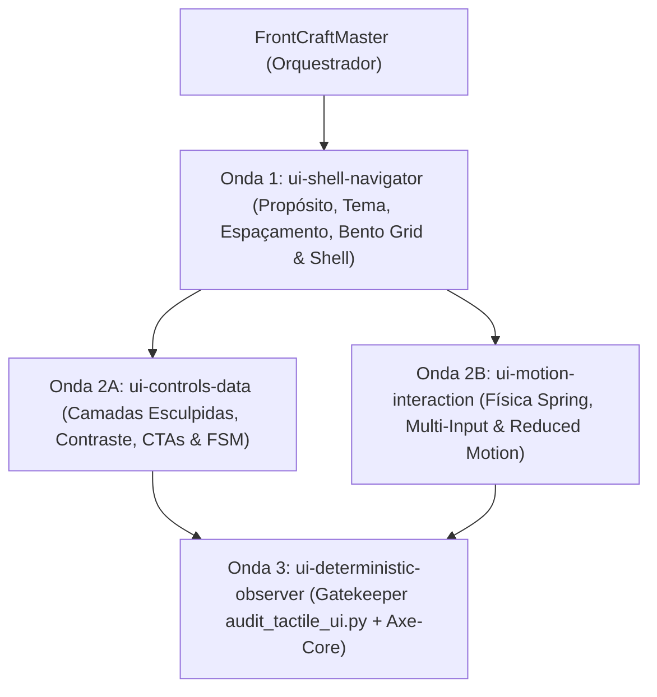

# Taxonomia de Subagentes Especialistas de UI/UX (`Topologia 3+1` — `v3.0.0`)

Mapeia a correspondência entre as 6 dimensões arquiteturais de UI/UX e a **Topologia Enxuta 3+1** (`ui-shell-navigator`, `ui-controls-data`, `ui-motion-interaction` e `ui-deterministic-observer`) coordenada por **`FrontCraftMaster`**, aplicando **Preferências de Estilo por Propósito** ([`preferencias_estilo_e_temas.md`](../../_template/references/preferencias_estilo_e_temas.md)).

---

## 1. Consolidação das 6 Dimensões na Topologia 3+1

| Agente Canônico (`agents/`) | Onda | Dimensões Absorvidas | Responsabilidade Arquitetural |
| :--- | :---: | :--- | :--- |
| **`ui-shell-navigator`** | Onda 1 | Fundações & Tokens + Layout Bento & Navegação | Seleção da atmosfera pelo propósito do projeto (*Ad Lucem*, *Cinza `#57545d` + Menus `#8e8999`*, *Preto Terminal IBM `Ex Umbris`*, *AETHER 2027*), Bento Grid 12 colunas (`CLS < 0.1`), espaçamento ($\ge 25\%$ respiro), raios concêntricos e navegação (`Ctrl+K`, pílula `#8e8999` ou sidebar tracker). |
| **`ui-controls-data`** | Onda 2A | Controles Interativos + Dados & Feedback | Cards esculpidos (`<SurfaceCard />` com sombra 3 camadas + `1px` Rim Light e blocos `--bg-contrast-card`), isolamento de 1 CTA primário sólido vs `.btn-ghost`, `tabular-nums`, alvos $\ge 44\times44\text{px}$ e estados FSM (`idle`, `loading`, `error`, `pressed`). |
| **`ui-motion-interaction`** | Onda 2B | Física de Movimento & Multi-Input | Curvas elásticas (`--ease-spring: cubic-bezier(0.22, 1, 0.36, 1)`), transições suaves de camada, suporte multi-input (Mouse, Touch, Pen, Keyboard) e `@media (prefers-reduced-motion: reduce)`. |
| **`ui-deterministic-observer`** | Onda 3 | Gatekeeper Determinístico (`frontend-testing-auditor` v3.0) | Executa `scripts/audit_tactile_ui.py` + `jest-axe`, valida `AUDIT-A11Y-01/02`, `AUDIT-VIS-01`, `AUDIT-STATE-01/02`, `AUDIT-SEC-01` e calcula $\text{Score} = 0.35\cdot A11y + 0.30\cdot FSM + 0.20\cdot Tokens + 0.15\cdot Sec$. |

---

## 2. Topologia de Execução (`plans/ui_composition_dag.json`)

