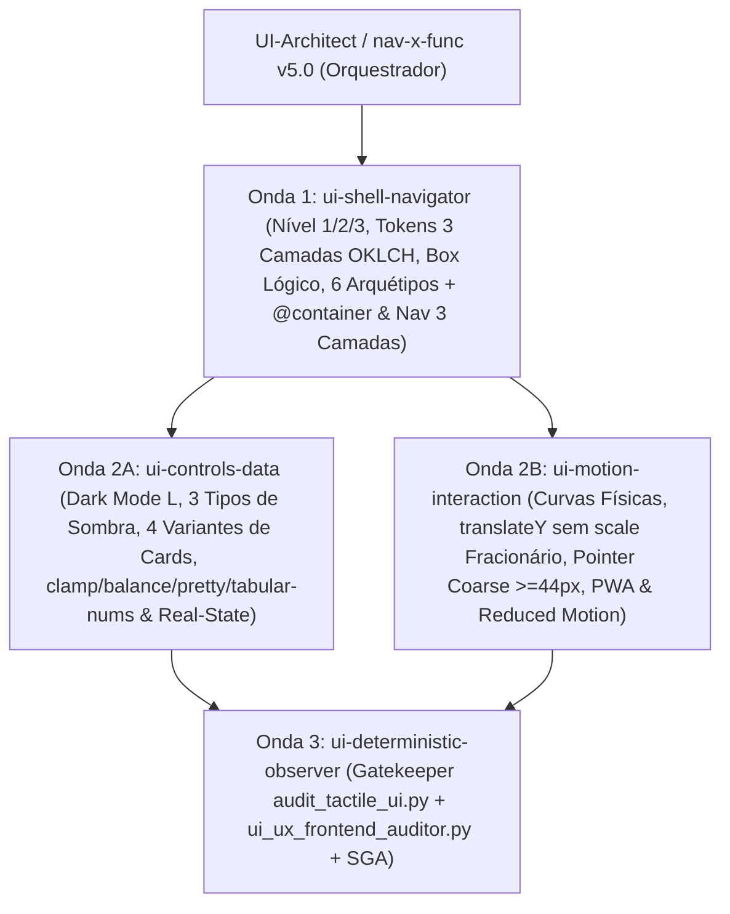

# Taxonomia de Subagentes Especialistas de UI/UX e Mapeamento dos 9 Eixos (`Topologia 3+1` — `v5.0.0`)

Mapeia a correspondência entre os **9 Eixos + Matriz de Complexidade** da SSOT ([`Preferências de Trabalho com Agentes.md`](file:///C:/Users/melki/dev/notes/Mem%C3%B3ria/Prefer%C3%AAncias%20de%20Trabalho%20com%20Agentes.md)) e a **Topologia Enxuta 3+1** (`ui-shell-navigator`, `ui-controls-data`, `ui-motion-interaction` e `ui-deterministic-observer`) coordenada por **`UI-Architect`** e **`nav-x-func`**.

---

## 1. Consolidação dos 9 Eixos na Topologia 3+1

| Agente Canônico (`agents/`) | Onda | Eixos Absorvidos | Responsabilidade Arquitetural |
| :--- | :---: | :--- | :--- |
| **`ui-shell-navigator`** | Onda 1 | **Eixos 1, 4, 6, 8 & 9** (Box Lógico, Tokens 3 Camadas, Macro/Microlayout, Nav 3 Camadas & 3 Níveis de Complexidade) | Seleção do **Nível de Complexidade (1: `@layer`, 2: SPA Feature-Driven, 3: App Router/PWA)**, tokens em **3 camadas (`OKLCH`, `light-dark()`, `color-mix()`)**, Box Model lógico (`inline-size`, `padding-inline`, `display: flow-root`, `gap`), **6 Arquétipos Espaciais** + `@container` e **Navegação em 3 Camadas** (*Global*, *Local/In-Page*, *Breadcrumbs* `<ol role="list">` + `aria-current="page"`, $\le 3$ cliques, `Ctrl+K`, Ordem DOM = Ordem Visual). |
| **`ui-controls-data`** | Onda 2A | **Eixos 2, 3, 5 & 7** (Tipografia Fluida Anti-Borrão, Dark Mode $L$, Sombras 3 Tipos, 4 Cards & Real-State) | Elevação progressiva no Dark Mode ($L = 0.16 \to 0.22 \to 0.27$), **3 tipos de sombra** (`box-shadow` Umbra+Penumbra com `spread` negativo + Catch-Light `inset 0 1px 0 0`, `text-shadow`, `filter: drop-shadow()`), `isolation: isolate`, **4 Variantes de Cards** (*Elevated*, *Outlined*, *Filled/Subtle*, *Interactive*), escala `clamp()`, `65ch`, `text-wrap: balance/pretty`, `antialiased` + `font-synthesis: none` + `tabular-nums`, zero emojis e **Engenharia Real-State** (zero placebos). |
| **`ui-motion-interaction`** | Onda 2B | **Eixos 6.2, 7.2 & 8.2** (Física de Movimento Sem Borrão GPU, Touch, PWA & Teclado) | Curvas `cubic-bezier(0.22, 1, 0.36, 1)` e `cubic-bezier(0.4, 0, 0.2, 1)`, feedback tátil (`translateY(-1px)`/`-2px` no `:hover`, `translateY(0px)` no `:active`, zero `scale()` fracionário em texto), `:focus-visible`, `@media (prefers-reduced-motion: reduce)`, `@media (pointer: coarse)` ($\ge 44\text{px}$) e `@media (display-mode: standalone)` (`user-select: none`). |
| **`ui-deterministic-observer`** | Onda 3 | **Gatekeeper Determinístico** (`frontend-testing-auditor` v5.0 + `frontend-ui-ux-auditor` v3.0 + `nav-x-func` v5.0) | Executa `scripts/audit_tactile_ui.py`, `scripts/ui_ux_frontend_auditor.py` e `scripts/deterministic_scorer.py`, validando `AUDIT-A11Y-01/02`, `AUDIT-VIS-01`, `AUDIT-VIS-EMOJI`, `AUDIT-VIS-BLOAT`, `AUDIT-STATE-01`, `AUDIT-SEC-01` e `SGA` ($\ge 90.0$). |

---

## 2. Topologia de Execução (`plans/ui_composition_dag.json`)

