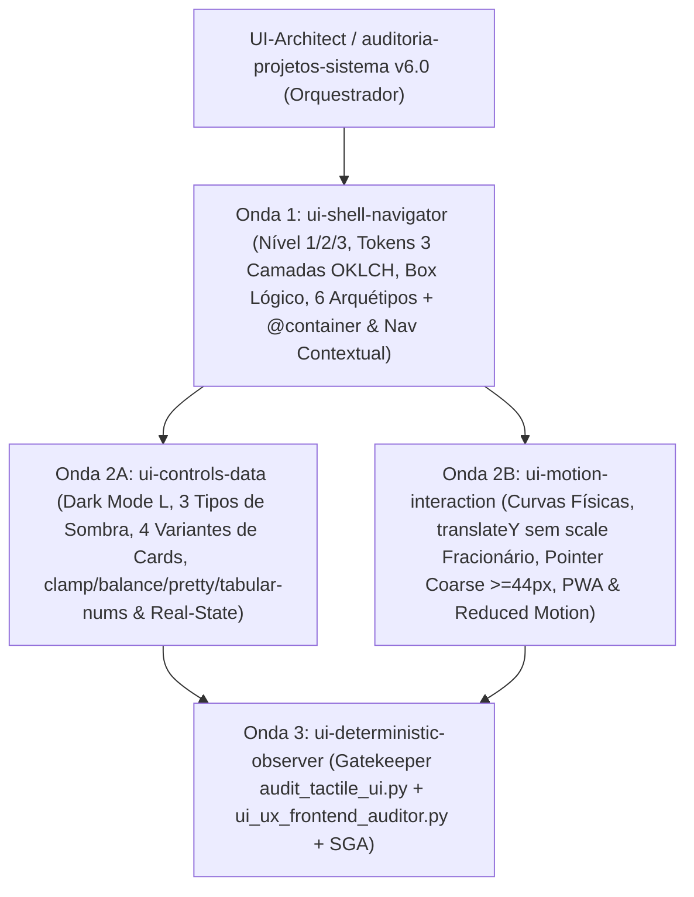

# Taxonomia de Subagentes Especialistas de UI/UX e Mapeamento dos 9 Eixos (`Topologia 3+1` — `v6.0.0`)

Mapeia a correspondência entre os **9 Eixos + Matriz de Complexidade** da SSOT ([`../../../rules/diretrizes-frontend-9-eixos.md`](../../../rules/diretrizes-frontend-9-eixos.md)) e a **Topologia Enxuta 3+1** (`ui-shell-navigator`, `ui-controls-data`, `ui-motion-interaction` e `ui-deterministic-observer`) coordenada por **`UI-Architect`** e **`auditoria-projetos-sistema`**.

---

## 1. Consolidação dos 9 Eixos na Topologia 3+1

| Agente Canônico (`agents/`) | Onda | Eixos Absorvidos | Responsabilidade Arquitetural |
| :--- | :---: | :--- | :--- |
| **`ui-shell-navigator`** | Onda 1 | **Eixos 1, 4, 6, 8 & 9** (Box Lógico, Espaçamento Primitivo/Semântico, Macro/Microlayout Grid/Flex/Subgrid, Nav Adaptável & 3 Níveis de Complexidade) | Seleção do **Nível de Complexidade (1: `@layer`, 2: SPA Feature-Driven, 3: App Router/PWA)**, tokens em **3 camadas (`OKLCH`, `light-dark()`, `color-mix()`, RCS)** + **Tokens de Espaçamento Primitivos (`--space-1..16`) e Semânticos Google Stitch (`--space-card-padding`, `--space-grid-gap`, `--space-section-inset`)**, Box Model lógico (`inline-size`, `padding-inline`, `display: flow-root`, `gap`), **Flexbox (`flex-wrap: balance`, `safe center`, `min-inline-size: 0`) vs. CSS Grid `RAM` + `subgrid`**, **6 Arquétipos Espaciais** + `@container` e **Navegação Adaptável de Único DOM** (*Bottom Nav* com `env(safe-area-inset-bottom)` $< 48\text{em}$ $\leftrightarrow$ *Sidebar Rail* `240px` `100dvh` $\ge 48\text{em}$, Popover intrínseco via `ResizeObserver`, *Breadcrumbs* `<ol role="list">` + `::before` silencioso + `aria-current="page"` $\ge 3:1$, Ordem DOM = Ordem Visual). |
| **`ui-controls-data`** | Onda 2A | **Eixos 2, 3, 5 & 7** (Hierarquia Visual 4 Pilares, Tipografia Fluida, Dark Mode $L$, Sombras 3 Tipos, Cards `<article>` 4 Regiões & Real-State) | Elevação progressiva no Dark Mode ($L = 0.16 \to 0.22 \to 0.27$), **3 tipos de sombra** (`box-shadow` Umbra+Penumbra com `spread` negativo + Catch-Light `inset 0 1px 0 0`, `text-shadow`, `filter: drop-shadow()`), `feColorMatrix`, `isolation: isolate`, **4 Variantes de Cards** em `<article>` com 4 regiões (`subgrid`, `:has(> img)`, clickable `a.card-link::after` stretch, choice `:has(> :checked)`, Raios Concêntricos $R_{\text{in}} = \max(4\text{px}, R_{\text{out}} - P)$), escala `clamp()` ($\max \le 2.5\times \min$), `60ch–65ch`, `text-wrap: balance/pretty`, `antialiased` + `font-synthesis: none` + `tabular-nums`, zero emojis e **Engenharia Real-State** (4 estados FSM, zero placebos). |
| **`ui-motion-interaction`** | Onda 2B | **Eixos 6.2, 7.2 & 8.2** (Física de Movimento Sem Borrão GPU, Lei de Fitts 48x48px, View Transitions, INP & Reduced Motion) | Curvas `cubic-bezier(0.22, 1, 0.36, 1)` e `cubic-bezier(0.4, 0, 0.2, 1)`, feedback tátil (`translateY(-2px)` no `:hover`, `scale(0.98)` ou `translateY(0px)` no `:active`, zero `scale()` fracionário em texto), `transition-behavior: allow-discrete` declarado em propriedade separada após `transition`, `@starting-style`, View Transitions API, Predictive Back (`scale(0.90)`), `:focus-visible`, `@media (prefers-reduced-motion: no-preference | reduce)`, `@media (any-pointer: coarse)` ($\ge 48\times 48\text{px}$, `gap >= 8px`, `touch-action: manipulation`), `content-visibility: auto` (baixo INP) e `@media (display-mode: standalone)` (`user-select: none`). |
| **`ui-deterministic-observer`** | Onda 3 | **Gatekeeper Determinístico** (`frontend-testing-auditor` v5.0 + `frontend-ui-ux-auditor` v3.1 + `auditoria-projetos-sistema` v6.0) | Executa `scripts/audit_tactile_ui.py`, `scripts/ui_ux_frontend_auditor.py` e `scripts/deterministic_scorer.py`, validando `AUDIT-A11Y-01/02`, `AUDIT-VIS-01`, `AUDIT-VIS-EMOJI`, `AUDIT-VIS-BLOAT`, `AUDIT-STATE-01`, `AUDIT-SEC-01` e `SGA` ($\ge 90.0$). |

---

## 2. Topologia de Execução (`plans/ui_composition_dag.json`)

