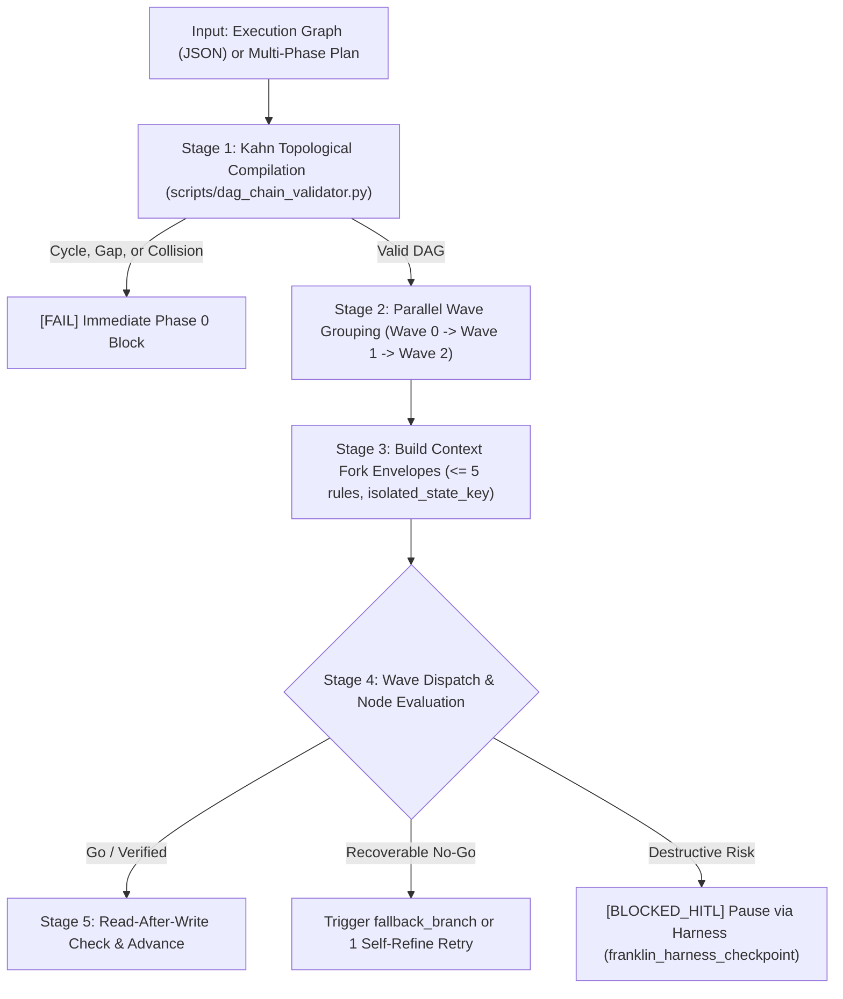

# DAG Engine Stages & Context Fork Architecture — `chained-plan-orchestrator`

Detailed 5-stage execution reference consumed by `SKILL.md` and backed by [`context_transition_schema.json`](context_transition_schema.json).

## Compilation & Dispatch Flowchart

## Stage Breakdown

1. **Stage 1 — Kahn Compilation, Ambiguity & Anti-Collision (`dag_chain_validator.py`):**
   - **Ambiguity Gate:** Block open `[GAP]` items back to planner/user before compiling waves.
   - **Cycle Detection (DAG):** Compute `in_degree`; if `visited_nodes < total_nodes`, abort with `[FAIL: CYCLE_DETECTED]`.
   - **Anti-Collision `[P]` (`target_files`):** Reject nodes in the same `Wave K` sharing `target_files` (`[FAIL: PARALLEL_FILE_COLLISION]`) until serialized.
   - **Catalog Validation:** Confirm `responsible_skill` / `target_skill` resolves to a valid skill slug.
2. **Stage 2 — Context Fork (`context_transition_schema.json`):** Instantiate `ContextTransitionPayload` (`phase_id`, `wave_index`, `sequence_index`, `target_skill`, `cognitive_pattern`, `isolated_state_key`, `input_payload`, `active_rules <= 5`, `target_files`, `expected_outputs`, `acceptance_criteria`, `fallback_branch`, `status`) with zero raw chat history.
3. **Stage 3 — Fan-Out & Fan-In:** Dispatch via `invoke_subagent` isolated by `isolated_state_key` or `franklin_execute_dag` (`run_id`, `--resume`, `idempotency_key`).
4. **Stages 4–5 — Non-Linear Routing, HITL & Read-After-Write:** Transition nodes cleanly across `COMPLETED` (after disk/test verification), `RETRYING` / `FALLBACK_ROUTED` (`max_retries = 1` -> `fallback_branch`), `BLOCKED_HITL` (`franklin_harness_guard` / `franklin_harness_checkpoint`), or `FAILED` (escalate trace to `gap-analyzer-auditor`).
