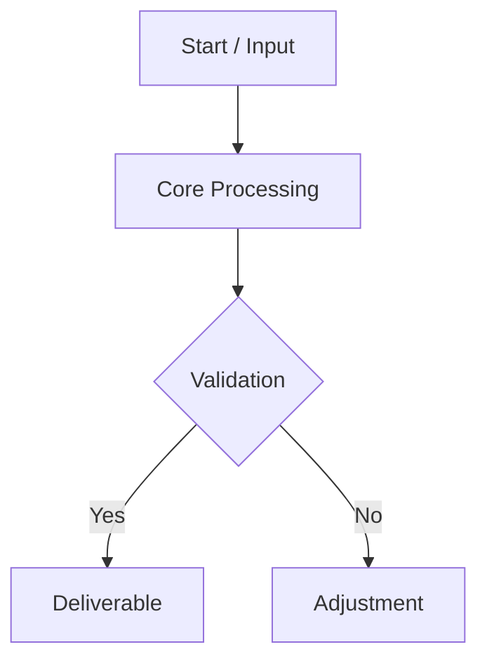

# Mermaid Diagramming Standards, Commented File Trees & Template (`flow-filetree-organizer` v1.2.0)

Tier-3 technical reference for parser-safe Mermaid flowcharts, commented ASCII directory trees, the canonical deliverable template, and `.md`/`.pdf` export rules.

---

## 1. Parser-Safe Mermaid Syntax Rules

1. **Supported Diagram Types**: Prefer `flowchart TD` (Top-Down) or `flowchart LR` (Left-Right).
2. **Mandatory Double Quotes on Labels with Special Characters**: Any node label containing `()`, `[]`, `/`, or `:` MUST wrap the label in double quotes:
   - Correct: `A["User Input (Web Form)"] --> B["Schema Validation"]`
   - Forbidden: `A[User Input (Web Form)]` (breaks Mermaid parser).
3. **Zero Raw HTML Tags**: Never place `<br>`, `<b>`, or `<div>` inside Mermaid node labels.

---

## 2. Commented ASCII Directory Tree Convention

```text
project-name/
├── src/                        # Main application source code
│   ├── core/                   # Pure domain rules and deterministic logic
│   ├── ui/                     # Decoupled interface components
│   └── main.py                 # Application entrypoint
├── tests/                      # Falsifiable automated test suite
├── .env.example                # Environment variable template (zero real secrets)
└── README.md                   # Quickstart and verified execution guide
```

---

## 3. Canonical Output Template

````markdown
file: [e.g., app_architecture_v1.md]
name: [Solution Name]
purpose: [Primary objective in 1 concise sentence]
version: [X.Y.Z] | date: [YYYY-MM-DD]

============================================================
Original request:
"[Exact verbatim text submitted by the user]"
============================================================

organization flow (stages & dependencies):
1. [Phase 0 / Input]
2. [Processing / Decision]
3. [Output / Deliverable]

### 1. Changelog
- v1.0.0 ([YYYY-MM-DD]): Initial structure.

### 2. Visual Workflow Diagram (Mermaid)


### 3. Project Structure & Commented File Tree
```text
my-project/
├── src/                # Core MVP modules
│   └── main.py         # Entrypoint and orchestration
├── tests/              # Automated tests
└── README.md           # Quick execution guide
```

### 4. Recommended Execution Flow
- Stage 1: ...
- Stage 2: ...

### 5. Optional Suggestions (Outside MVP)
- [Decoupled optional enhancement]

### 6. Export Option (.md / .pdf)
- Would you like to save this layout to a `.md` file in the workspace or export to `.pdf` via `html-pdf-converter`?
````

---

## 4. Direct Export Pipeline (`.md` / `.pdf`)

- **Single Markdown File (`.md`)**: Persist in UTF-8 enforcing blank lines before and after every ```` ```mermaid ```` and ```` ```text ```` block.
- **PDF Conversion (`.pdf`)**: Delegate to `html-pdf-converter` (headless Microsoft Edge `--print-to-pdf`) with `break-inside: avoid` CSS rules on diagrams and directory trees.
