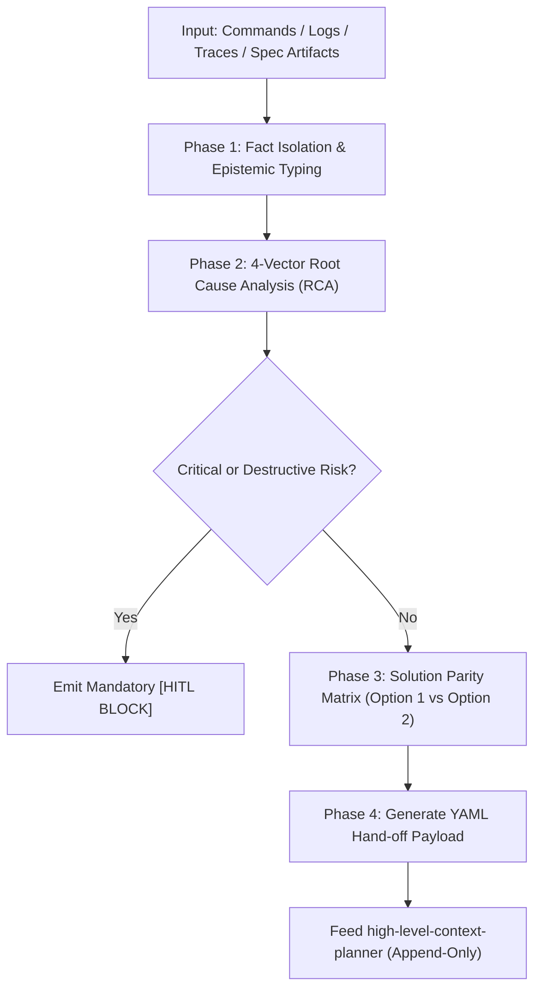

# Mermaid Pipeline, RCA Vectors & Canonical Report Template — `gap-analyzer-auditor`

Visual workflow reference and report contract consumed by [`SKILL.md`](../SKILL.md). See also [`closed_loop_architecture.md`](closed_loop_architecture.md), [`rca_failure_taxonomy.md`](rca_failure_taxonomy.md), and [`handoff_payload_schema.json`](handoff_payload_schema.json).

## Closed-Loop Audit Flowchart



## The 4 Root Cause Vectors

1. **Context / Injection Failure:** Missing parameters, ambiguous prompts, Complexity Wall breaches (`> 5` rules/node), or permissive schemas.
2. **Tooling / MCP Protocol Failure:** Invalid API payloads, timeouts, tool misuse, STDIO leaks, or protocol version drift.
3. **Architecture Bottleneck:** Circular graph dependencies, parallel `[P]` file collisions, unbounded loops, or token budget overflow.
4. **Security & Reliability Risk:** Unconfirmed destructive mutations, PII exposure, or leaked credentials.

## Canonical Audit Report Template

````markdown
# TECHNICAL AUDIT, RCA & SPEC-TO-CODE CONVERGENCE REPORT

## 1. Factual Mapping & Anomaly / Convergence Summary
- **Audited Target:** [Process, pipeline, file, or spec under analysis]
- **Verdict Status:** [CRITICAL / WARNING / SUBOPTIMAL / CONVERGED / COMPLIANT]
- **Epistemic Classification:**
  - `[FACT]`: [Verbatim log entry, trace line, or verified disk file state]
  - `[INFERENCE]`: [Causal deduction linking facts to observed error or spec drift]
  - `[GAP]`: [Missing or truncated telemetry preventing full confirmation]

## 2. Root Cause Diagnosis (RCA) or Convergence Gaps
- **Failure / Drift Mechanism:** [Cause -> Propagation -> Impact]
- **Breakage Point:** [Exact stage, function, FR-### requirement, or file path]
- **Residual Risk:** [Impact if left unresolved]

## 3. Solution Alternative Matrix
| Identifier | Approach | Pros | Cons / Trade-offs | Complexity |
| :--- | :--- | :--- | :--- | :---: |
| **Option 1 (Surgical)** | [Immediate targeted patch] | Low effort | May mask deeper structural flaws | Low |
| **Option 2 (Architectural)** | [Structural contract fix] | Robust long-term prevention | Requires contract refactor | Medium/High |

## 4. Planner Feedback Contract (YAML Hand-Off Payload)
```yaml
handoff_target: "high-level-context-planner"
incident_id: "AUDIT-[YYYY-MM-DD]-[SEQ]"
recommended_option: "Option 2"
required_adjustments:
  - step: "[Affected stage]"
    action: "REFACTOR"
    patch_instructions: "[Atomic instruction (<= 5 active rules)]"
  - step: "Phase N: Spec-to-Code Convergence"
    action: "APPEND_CONVERGENCE_TASKS"
    patch_instructions: "Append without modifying completed tasks: - [ ] T0XX [P] [CONV] src/exact/path.py"
contingency_trigger: "[Deterministic fallback condition]"
```
````
