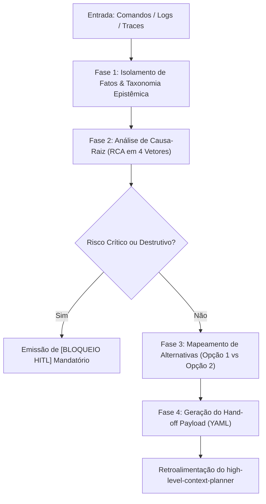

# Fluxo Mermaid, Vetores RCA e Template Canônico — Gap Analyzer Auditor

Referência completa de pipeline visual e modelo de entrega usada por [`../SKILL.md`](../SKILL.md). Consulte também [`arquitetura_closed_loop.md`](arquitetura_closed_loop.md), [`taxonomia_rca_falhas.md`](taxonomia_rca_falhas.md) e [`schema_handoff_payload.json`](schema_handoff_payload.json).

## Fluxo Closed-Loop



## 4 Vetores de Causa-Raiz (RCA)

1. **Falha de Contexto / Injeção:** Parâmetros ausentes, prompts ambíguos, estouro da Parede de Complexidade ($> 5$ regras/nó) ou schemas incompatíveis.
2. **Falha de Ferramenta / MCP:** Retorno inválido de API, timeout, tool misuse ou discrepância de versão de protocolo.
3. **Gargalo de Arquitetura:** Dependência circular, colisão de escrita paralela (`[P]`), loop sem condição de parada ou estouro de token budget.
4. **Risco de Segurança / Confiabilidade:** Mutações irreversíveis sem HITL, vazamento de PII ou exposição de credenciais.

## Modelo Canônico de Relatório

````markdown
# RELATÓRIO DE AUDITORIA TÉCNICA, RCA E CONVERGÊNCIA SPEC-TO-CODE

## 1. Mapeamento Factual e Síntese da Anomalia / Convergência
- **Alvo Auditado:** [Nome do processo, pipeline, arquivo ou skill sob análise]
- **Status do Veredito:** [CRÍTICO / ALERTA / SUBÓTIMO / CONVERGED / CONFORME]
- **Classificação da Informação:**
  - `[FATO]`: [Evidência textual exata, registro de log ou estado real do arquivo no disco]
  - `[INFERÊNCIA]`: [Dedução analítica da causa imediata do erro ou da divergência Spec-to-Code]
  - `[LACUNA]`: [Dados ausentes que limitam o diagnóstico definitivo]

## 2. Diagnóstico da Causa-Raiz (RCA) ou Lacunas de Convergência
- **Mecanismo da Falha / Brecha:** [Causa -> Propagação -> Impacto]
- **Ponto de Quebra:** [Etapa, função, requisito FR-### ou arquivo específico]
- **Risco Residual:** [Impacto caso não corrigido]

## 3. Matriz de Alternativas de Solução
| Identificador | Abordagem | Vantagens | Desvantagens / Trade-offs | Complexidade |
| :--- | :--- | :--- | :--- | :---: |
| **Opção 1 (Cirúrgica)** | [Ajuste rápido] | Baixo esforço | Pode mascarar causas estruturais | Baixa |
| **Opção 2 (Arquitetural)** | [Correção definitiva] | Robustez e prevenção | Exige refatoração de contratos | Média/Alta |

## 4. Contrato de Retroalimentação para o Planejador (Hand-off Payload)
```yaml
handoff_target: "high-level-context-planner"
incident_id: "AUDIT-[DATA]-[SEQ]"
recommended_option: "Opção 2"
required_adjustments:
  - step: "[Etapa afetada]"
    action: "REFATORAR"
    patch_instructions: "[Instrução atômica (<= 5 regras)]"
  - step: "Fase N: Convergência Spec-to-Code"
    action: "APPEND_CONVERGENCE_TASKS"
    patch_instructions: "Anexar ao final do plano sem reescrever tasks concluídas: - [ ] T0XX [P] [CONV] src/caminho/exato.py"
contingency_trigger: "[Condição de fallback]"
```

**Deseja acionar o `high-level-context-planner` agora com este payload para emitir o plano corretivo revisado (Convergência Append-Only), ou deseja ajustar a alternativa recomendada?**
````
