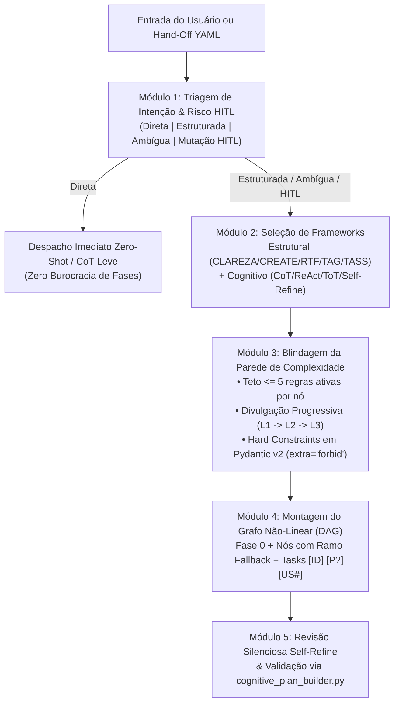

# SKILL: Motor Cognitivo de Intenção, Frameworks e Planejamento Não-Linear (`high-level-context-planner` / `intent-cognitive-planner` v3.0.0)

## 1. Objetivo, Missão Arquitetural e Quando Usar (Gatilhos)

Esta Skill atua como o **motor cognitivo de diagnóstico de intenção, seleção de frameworks, blindagem contra a Parede de Complexidade e planejamento adaptativo em grafo (DAG)**. Ela unifica o planejamento estratégico Spec-Driven (`Fase 0`, tasks paralelizáveis `[ID] [P?] [US#]` e Convergência *Append-Only*) com o motor **`intent-cognitive-planner`**, erradicando dois problemas críticos de agentes tradicionais:
1. **O Planejamento Linear Rígido ($A \rightarrow B \rightarrow C \rightarrow D$):** A suposição ingênua de que tarefas complexas seguem uma linha reta sem observação empírica de ferramentas externas (`ReAct`), sem exploração de hipóteses concorrentes (`Tree of Thoughts`) e sem crítica reflexiva pré-entrega (`Self-Refine`).
2. **A Parede de Complexidade de Prompts (*Prompt Complexity Wall*):** A degradação exponencial da acurácia do LLM quando um prompt ou nó de execução acumula mais de 5 a 10 regras simultâneas (fazendo a aderência colapsar para $< 15\%$).

### Quando Usar
- Diante de solicitações complexas, épicos de engenharia, refatorações multifásicas ou ideias exploratórias que exigem triagem de intenção e decomposição em grafo não-linear.
- Para selecionar e combinar frameworks estruturais (`CLAREZA`, `CREATE`, `RTF`, `TAG`, `TASS`) com padrões cognitivos não-lineares (`CoT`, `ReAct`, `ToT`, `Self-Refine`).
- Para auditar e subdividir planos que violem o teto de **$\le 5$ regras ativas por nó** via `scripts/cognitive_plan_builder.py`.
- Quando o `gap-analyzer-auditor` emitir um `Hand-off Payload (YAML)`, exigindo um **Plano de Convergência *Append-Only* (v2.0+)** sem reescrever o histórico.

### Quando NÃO Usar (Limites e Exclusões)
- Para tarefas triviais de comando único (`Categoria 1: Direta`), nas quais o próprio diagnóstico determina entrega imediata sem burocracia de fases.
- Para executar mutações destrutivas diretamente no disco ou banco de dados sem passar por worker/subagente e portão HITL.
- Para realizar RCA forense de logs e stack traces brutos antes de diagnosticar a falha (utilize primeiro `gap-analyzer-auditor`).

---

## 2. Entradas e Parâmetros Esperados

1. **`strategic_goal` / `user_query`** (obrigatório): O pedido do usuário, meta técnica, requisito funcional ou ideia bruta.
2. **`handoff_payload`** (condicional): Bloco YAML emitido pelo `gap-analyzer-auditor` (`incident_id`, `recommended_option`, `required_adjustments`, `contingency_trigger`) para replanejamento *Append-Only*.
3. **`operational_constraints`** (opcional): Restrições de ambiente, orçamento de tokens, caminhos-alvo (`target_dir`) e teto de regras por nó (`max_rules_per_node = 5`).

---

## 3. Arquitetura, Módulos e Fluxo de Processamento



### Módulo 1: Triagem e Diagnóstico Semântico de Intenção (4 Quadrantes)
Ao receber a demanda, classifique a intenção antes de gerar qualquer plano:

| Categoria da Intenção | Definição Semântica | Padrão de Despacho | Padrão Cognitivo Primário |
| :--- | :--- | :--- | :--- |
| **`1. direta`** | Comando pontual, conversão, consulta ou ajuste de arquivo único sem ambiguidade. | Entrega direta sem plano multifásico desnecessário. | `Zero-Shot` / `CoT` leve |
| **`2. estruturada`** | Demanda multifacetada com dependências entre módulos, testes ou múltiplos arquivos. | Grafo não-linear (DAG) com Fase 0, pré-condições, tasks `[ID] [P?] [US#]` e fallbacks. | `ReAct` (com tools) ou `CoT` + `ToT` |
| **`3. ambigua`** | Pedido exploratório ("tenho uma ideia", "como arquitetar X"). | Formulação de hipóteses concorrentes, poda de ramos inviáveis e definição de MVP. | `CREATE` + `Tree of Thoughts (ToT)` |
| **`4. mutacao_critica_hitl`** | Ações irreversíveis: deleção em massa, drop/alteração de banco, deploy externo, credenciais. | **Pausa imediata e serialização de checkpoint** (`requer_hitl: true`). | `ReAct` com `Approval Gate (HITL)` |

### Módulo 2: Seleção Combinada de Frameworks (Estrutural + Cognitivo)
Combine sempre **1 Framework Estrutural** (formato do entregável) com **1 a 3 Padrões Cognitivos Não-Lineares** (motor de raciocínio de cada nó):

1. **Frameworks Estruturais**:
   - **`CLAREZA`** (*Contexto, Limites, Ação, Referência, Exemplos, Zelo, Avaliação*): Código de produção, auditorias técnicas, contratos MCP/Pydantic e tarefas onde a taxa de alucinação deve ser zero.
   - **`CREATE`** (*Character, Request, Examples, Adjustments, Type, Extras*): Ideação de produtos, especificações (`SPEC.md` / PRDs), arquiteturas do zero e MVPs.
   - **`RTF`** (*Role, Task, Format*): Microtransformações, extração estruturada e tabelas rápidas.
   - **`TAG`** (*Task, Action, Goal*): Automações operacionais enxutas e scripts diretos.
   - **`TASS`** (*Task, Audience, Style, Structure*): Documentação executiva ou comunicação adaptada ao público-alvo.

2. **Padrões Cognitivos Não-Lineares**:
   - **`CoT` (Chain-of-Thought)**: Dedução explícita (*causa $\rightarrow$ consequência $\rightarrow$ decisão*) para validação de pré-condições e cálculos determinísticos.
   - **`ReAct` (Reason-and-Act)**: Ciclo contínuo *Pensamento $\rightarrow$ Tool Call $\rightarrow$ Observação*, recalibrando o plano conforme a resposta real do sistema de arquivos, AST ou API.
   - **`ToT` (Tree of Thoughts)**: Geração de ramos arquiteturais concorrentes (ex.: Opção 1 Cirúrgica vs. Opção 2 Estrutural), avaliação contra critérios Go/No-Go e poda de ramos subótimos.
   - **`Self-Refine` (Reflexion)**: Loop interno *Gerador $\rightarrow$ Crítico Determinístico $\rightarrow$ Refinador* antes de dar a etapa por concluída.

### Módulo 3: Blindagem contra a Parede de Complexidade (*Prompt Complexity Wall Shield*)
Para manter a confiabilidade de execução $\ge 90\%$ em cada etapa do plano, aplique obrigatoriamente as 4 salvaguardas:
1. **Teto Estrito de Regras por Nó ($\le 5$ guardrails):** Cada nó do `grafo_execucao` deve possuir `regras_ativas_count <= 5`. Se uma etapa acumular 6 ou mais restrições, subdivida-a em dois nós atômicos sequenciais ou paralelos (`step_02a`, `step_02b`).
2. **Divulgação Progressiva (*Progressive Disclosure* `L1 -> L2 -> L3`):**
   - **Camada L1 (Metadados Globais):** Objetivo e intenção (~100 tokens).
   - **Camada L2 (Instrução Operacional do Nó):** Apenas o procedimento da etapa ativa.
   - **Camada L3 (Schemas, Regras e Scripts):** Carregados sob demanda apenas pelo nó que os executa.
3. **Hard Constraints em Código vs. Soft Constraints no Prompt:** Validações de schema, contagens, segurança AST e limites numéricos devem ser impostos por contratos **Pydantic v2 (`extra="forbid"`)** ou scripts em `scripts/`, nunca por súplicas textuais no prompt.
4. **Isolamento via Subagentes (*Context Fork*):** Tarefas marcadas com `[P]` que tocam arquivos disjuntos rodam em contextos isolados, retornando apenas o artefato validado.

### Módulo 4: Fase 0, Notação `[ID] [P?] [US#]` e Convergência *Append-Only* (`v2.0+`)
- **Fase 0 Mandatória (`step_00_fase_zero`)**: Validação de pré-requisitos, schemas, caminhos no disco e teto de complexidade antes de mutações.
- **Checklist Executável (`[ID] [P?] [US#] caminho/exato.ext`)**:
  - `[ID]`: Identificador sequencial imutável (`T001`, `T002`...).
  - `[P]`: Task paralelizável que **edita arquivo distinto** sem conflito de escrita na mesma onda.
  - `[US#]`: Requisito ou fatia associada (`[US0]`, `[MVP]`, `[CONV]`).
- **Convergência *Append-Only* (`/speckit-converge`)**: Ao consumir um `handoff_payload` do `gap-analyzer-auditor`, **NUNCA apague, renumere ou reescreva tasks já concluídas (`[x] T001`)**. Anexe uma nova seção `## Fase N: Convergência & Mitigação` com tasks `- [ ] T0XX [P] [CONV] caminho/exato.py`.

---

## 4. Automação Determinística (`scripts/cognitive_plan_builder.py`)

Execute o motor determinístico da skill para diagnosticar intenções, validar o teto de $\le 5$ regras por nó (auto-subdividindo nós sobrecarregados) e exportar o grafo para o motor DAG do `epic-volta`:

```powershell
# Auto-teste determinístico das regras cognitivas, Pydantic v2 e Complexity Wall Shield
uv run python skills/high-level-context-planner/scripts/cognitive_plan_builder.py --self-test

# Gerar plano cognitivo não-linear JSON a partir de uma intenção
uv run python skills/high-level-context-planner/scripts/cognitive_plan_builder.py --intent "Refatorar módulo de autenticação OAuth2 e criar suíte de testes unitários" --framework CLAREZA

# Validar um plano JSON existente e converter para DAGExecutionPlan (Epic-Volta)
uv run python skills/high-level-context-planner/scripts/cognitive_plan_builder.py --validate-file caminho/plano.json --export-dag caminho/dag_plan.json
```

---

## 5. Saídas e Entregáveis (Contrato Híbrido: Grafo JSON + Plano Executivo Markdown)

Quando acionada para planejar demandas das categorias `estruturada`, `ambigua` ou `mutacao_critica_hitl`, emita:

### 5.1. Contrato JSON do Plano Adaptativo Executável (`references/schema_plano_contexto.json`)
```json
{
  "plan_id": "plan-cognitive-001",
  "version": "3.0.0",
  "target_orchestrator": "skill-orquestrador-planos-encadeados",
  "strategic_goal": "Descrição clara do objetivo final",
  "intencao": {
    "categoria": "estruturada",
    "diagnostico": "Causa raiz e objetivo prático da demanda",
    "requer_hitl": false
  },
  "frameworks_selecionados": {
    "estrutural": "CLAREZA",
    "cognitivo": ["CoT", "ReAct", "ToT", "Self-Refine"]
  },
  "blindagem_complexidade": {
    "status": "SHIELDED",
    "max_regras_por_no": 3,
    "disclosure_tier": 2,
    "estrategia": "Decomposição atômica em nós com <= 5 regras ativas e divulgação progressiva L1->L2->L3"
  },
  "grafo_execucao": [
    {
      "etapa_id": "step_00_fase_zero",
      "nome": "Fase 0: Diagnóstico de Pré-condições e Schemas",
      "responsible_skill": "high-level-context-planner",
      "tipo_execucao": "model_reasoning",
      "padrao_cognitivo": "CoT",
      "regras_ativas_count": 2,
      "regras_ativas": ["Validar caminhos reais no disco", "Verificar schemas Pydantic v2"],
      "precondicoes": [],
      "target_files": ["shared/modular_orchestrator.py"],
      "criterio_aceite": "[PASS] Pré-requisitos e schemas validados sem ciclos",
      "ramo_fallback": "step_00_clarify_inputs"
    },
    {
      "etapa_id": "step_01_execucao_react",
      "nome": "Fase 1: Implementação e Observação Empírica (P1 MVP)",
      "responsible_skill": "code-acceptability-auditor",
      "tipo_execucao": "tool_io",
      "padrao_cognitivo": "ReAct",
      "regras_ativas_count": 3,
      "regras_ativas": ["Manter McCabe <= 10", "Tipagem estrita Pydantic v2", "Zero bare except"],
      "precondicoes": ["step_00_fase_zero"],
      "target_files": ["src/modulo.py"],
      "criterio_aceite": "[PASS] Quality Score AST >= 75 e Exit Code 0",
      "ramo_fallback": "step_01_tot_alternative"
    }
  ]
}
```

### 5.2. Resumo Executivo Markdown com Tasks `[ID] [P?] [US#]` e `Complexity Tracking`
Acompanhe o grafo com:
1. **Diagrama Mermaid (`flowchart TD`)** exibindo o caminho principal e os ramos de fallback (`ramo_fallback`).
2. **Checklist de Tasks Executáveis (`- [ ] T001 [P] [US1] caminho/arquivo.ext`)** por fase.
3. **Matriz de Decisão Go/No-Go** falsificável (`[PASS]` / `[FAIL]` / Rota de Contingência).
4. **Tabela `Complexity Tracking` (Vacina YAGNI)** justificando qualquer abstração extra.

---

## 6. Protocolo de Revisão Silenciosa (`Self-Refine`) e Guardrails (Restrições)

Antes de emitir o plano final, valide silenciosamente:
- ❌ **Proibição de Planejamento Linear Cego em Tarefas com Incerteza**: Se uma etapa depende da leitura do disco, rede ou testes, use o padrão **`ReAct`** ou **`ToT`** e declare um `ramo_fallback` explícito.
- ❌ **Proibição de Violar a Parede de Complexidade (`> 5` regras/nó)**: Nenhum nó do `grafo_execucao` pode ter `regras_ativas_count > 5`. Subdivida nós complexos.
- ❌ **Proibição de Pular a Fase 0 ou Reescrever Histórico na Convergência**: Toda esteira estruturada inicia na Fase 0 e todo replanejamento pós-auditoria é estritamente *append-only*.
- ❌ **Proibição de Paralelismo Conflitante (`[P]`)**: Duas tasks paralelas na mesma onda nunca podem editar o mesmo arquivo em `target_files`.
- ❌ **Bloqueio HITL Obrigatório**: Qualquer intenção classificada como `mutacao_critica_hitl` exige `requer_hitl: true` e nó de aprovação humana antes da mutação.
