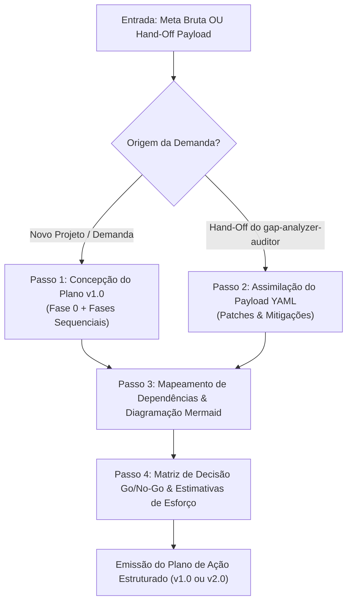
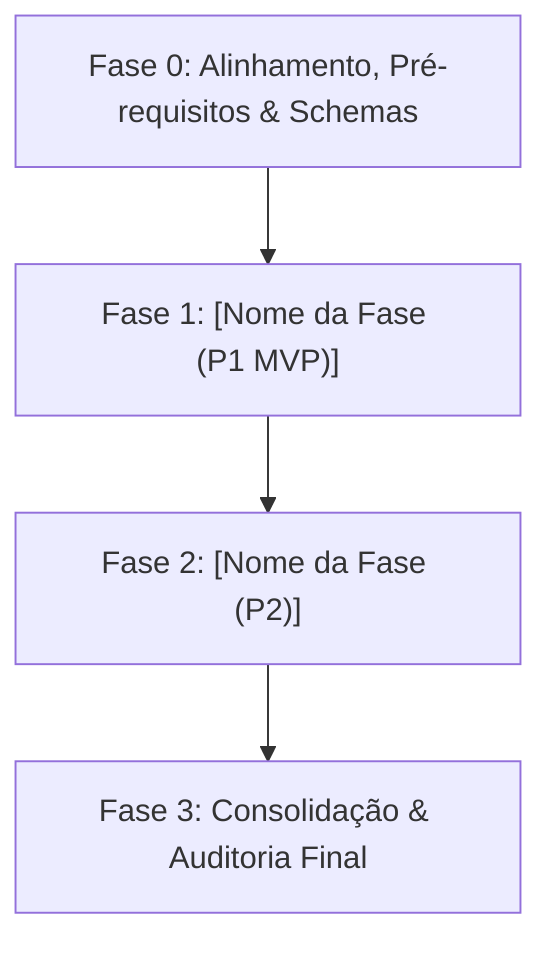

# SKILL: Planejador Estratégico de Contexto de Alto Nível (`high-level-context-planner` v2.1.0)

## 1. Identificação e Metadados
- **Nome Oficial**: `high-level-context-planner`
- **Identificador de Ativo**: `SKILL_HIGH_LEVEL_CONTEXT_PLANNER_V2_1`
- **Versão de Referência**: `2.1.0`
- **Compatibilidade Normativa**: Multi-LLM (Gemini 2.5+, Claude 3.5+, GPT-4o+, Google ADK, LangGraph, MCP Spec 2026-07-28, GitHub Spec Kit SDD).
- **Papel na Arquitetura**: Nó Planejador Estratégico em malha fechada (*Strategic Planner, Spec-Driven Coordinator & State Graph Architect*).

---

## 2. Propósito e Missão (Quando Usar)

### Quando Usar
Esta skill **DEVE** ser acionada nas seguintes circunstâncias:
- Diante de solicitações complexas, épicos de desenvolvimento, migrações de sistemas ou demandas multifásicas que exigem decomposição arquitetural.
- Para gerar planos de trabalho executivos com fases numeradas, atribuição de agentes/skills, insumos, entregáveis e critérios de aceite Go/No-Go.
- Quando o `gap-analyzer-auditor` emitir um relatório de anomalia acompanhado de `Hand-off Payload (YAML)`, demandando a geração de um **Plano de Ação Corretivo Revisado (Plano v2.0)**.
- Para estruturar fluxos visuais em diagramas Mermaid claros (`flowchart TD`/`LR`), prevenindo dependências circulares e gargalos de contexto.
- Em pipelines orquestrados por `skill-orquestrador-planos-encadeados`, servindo como o motor formal de planejamento inicial e de contingência.

### Quando NÃO Usar
- Para tarefas simples de comando único ou scripts utilitários descartáveis sem transição de fases.
- Para executar ações diretas de mutação no disco, compilação ou chamadas destrutivas (a execução cabe aos executores ou subagentes operários).
- Para realizar auditoria e RCA isolado de falhas em tempo de execução (utilize `gap-analyzer-auditor`).
- Para tarefas que violem as políticas de menor privilégio ou exijam credenciais de infraestrutura não concedidas.

---

## 3. Entradas Obrigatórias e Parâmetros

1. **`strategic_goal`** (obrigatório): O objetivo final, briefing de projeto, requisitos funcionais ou demanda bruta do usuário.
2. **`handoff_payload`** (condicional): O bloco YAML estruturado emitido pelo `gap-analyzer-auditor` contendo `incident_id`, `recommended_option`, `required_adjustments` e `contingency_trigger` (obrigatório em ciclos de replanejamento).
3. **`available_skills_catalog`** (opcional): Catálogo de skills disponíveis no workspace para mapeamento de responsáveis.
4. **`operational_constraints`** (opcional): Prazos, orçamento de tokens, restrições de rede ou premissas técnicas específicas.

---

## 4. Diretrizes de Estilo por Propósito e Arquitetura Visual (`preferencias_estilo_e_temas.md`)

Sempre que o planejamento envolver entregas de interfaces, arquiteturas frontend, painéis de controle ou relatórios visuais, a skill aplica as preferências de estilo guiadas pelo **propósito do projeto** (consulte [`../_template/references/preferencias_estilo_e_temas.md`](../_template/references/preferencias_estilo_e_temas.md)):

### Módulo 1: Seleção da Atmosfera pelo Propósito (Sem Paleta Fixa)
- **Ad Lucem (Claro Editorial/Técnico)**: Canvas (`#F3F3F5` / `#F6F6F4`), Card (`#FFFFFF`), Elevado (`#E6E6EA`) e Bloco de Contraste Alternado (`#18181C`).
- **Cinza sobre Cinza Monolítico**: Canvas (`#57545d`), Card (`#49464f`), Elevado (`#635f6a`) e Menus em pílula `#8e8999` com tinta escura nítida (`#16151A`).
- **Preto Terminal IBM (`Ex Umbris`)**: Canvas (`#070709`), Card (`#101014`), Elevado (`#18181E`), acoplado à tipografia **`IBM Plex Sans` + `IBM Plex Mono`**.
- **Acento Pontual de Intenção (98/2 ou 60-30-10)**: Escolhido conforme o objetivo do sistema e isolado em **1 único CTA primário sólido** por dobra vs. `.btn-ghost`.

### Módulo 2: Contraste, Espaçamento, Tipografia e Camadas Esculpidas
- **Profundidade e Luz de Borda**: No dark mode, $L_{\text{card}} > L_{\text{canvas}}$. Elevação com sombra esculpida em 3 camadas (`--shadow-sculpted`) + `1px` Rim Light superior (`inset 0 1px 0 0 var(--rim-light)`).
- **Espaçamento, Tipografia & Anti-Squish**: Respiro $\ge 25\%$ do canvas, escala `clamp()`, `tabular-nums` em métricas e alvos $\ge 44\times44\text{px}$ (`flex-shrink: 0; white-space: nowrap;`).

### Módulo 3: Mapeamento de Opções das Preferências do Desenvolvedor
- **Prioridade para Design Atômico em 5 Camadas**: Todo plano envolvendo UI prioriza componentes modulares (**shadcn/ui**, **Radix UI**, **Lucide Icons**) estruturados nas 5 camadas do `frontend-code-architect` (`v5.0`).
- **Bifurcações com `ask_question`**: Quando houver alternativas concorrentes de arquitetura, incluir paradas controladas com formulários de múltipla escolha.

### Módulo 4: Matriz de Detecção de Discrepâncias com as Preferências
- Checklist determinístico que governa as fases planejadas:
  * `[PASS / FAIL]` **Tema Alinhado ao Propósito (`AUDIT-VIS-01`)**: Sem paleta fixa repetitiva e com isolamento de 1 CTA primário.
  * `[PASS / FAIL]` **Fase 0 Obrigatória**: Presença de alinhamento e pré-requisitos antes do código.
  * `[PASS / FAIL]` **Critérios Go/No-Go Falsificáveis**: Regras determinísticas de transição de fase.
  * `[PASS / FAIL]` **Prevenção de Sobre-Engenharia (KISS)**: Sem servidores mockados ou stacks web pesadas quando primitivas locais bastam.

---

## 5. Processamento Passo a Passo (Protocolo de Planejamento e Replanning)



### Passo 1: Concepção do Plano Inicial (v1.0) & Notação Executável `spec-kit`
1. Analisar a meta e isolar o escopo do projeto em fatias independentemente testáveis (`P1 MVP`, `P2`, `P3`). Se houver requisito crítico ambíguo que não possa ser inferido com segurança, marcá-lo explicitamente com `[NEEDS CLARIFICATION: motivo]`.
2. **Fase 0 Mandatória**: Toda esteira deve iniciar com a Fase 0 cobrindo validação de pré-requisitos, schemas de dados, variáveis de ambiente, diretrizes de design e verificação de caminhos canônicos.
3. Decompor os objetivos em fases numeradas (Fase 1, Fase 2, Fase 3...), cada uma contendo:
   - Objetivo específico da fase e Skill / Agente responsável pela execução.
   - **Checklist de Tasks com Notação Paralela (`[ID] [P?] [US#] caminho/exato.ext`)**:
     - `[ID]`: Identificador sequencial imutável (`T001`, `T002`...).
     - `[P]`: Marcador explícito para tarefas que tocam **arquivos diferentes sem dependência entre si** e podem ser despachadas em subagentes paralelos (`invoke_subagent` / nós do DAG) sem conflito de escrita.
     - `[US#]`: Fatia de história/requisito correspondente (`[US1]`, `[MVP]`, `[CONV]`).
   - Insumos requeridos (inputs), entregáveis esperados (outputs), critérios Go/No-Go (`[PASS]` / `[FAIL]`) e esforço relativo (Baixo / Médio / Alto).

### Passo 2: Assimilação do Hand-Off Payload e Convergência *Append-Only* (v2.0)
1. Extrair os campos estruturados do payload YAML: `incident_id`, `recommended_option`, `required_adjustments` e `contingency_trigger`.
2. **Regra de Convergência *Append-Only* (`/speckit-converge`)**:
   - Em ciclos de replanejamento ou convergência pós-implementação, **NUNCA apague, renumere ou reescreva tarefas já concluídas (`[x] T001`)**.
   - Aplique os ajustes necessários (`REFATORAR`, `INSERIR_GUARDRAIL`, `REMOVER_DEPENDENCIA`, `ADICIONAR_RETRY`, `BLOQUEIO_HITL` ou `APPEND_CONVERGENCE_TASKS`) anexando uma nova seção **`## Fase N: Convergência & Mitigação`** ao final do plano com novas tasks sequenciais (`- [ ] T0XX [P] [CONV] caminho/exato.py`).

### Passo 3: Mapeamento de Dependências e Diagramação Mermaid
Elaborar fluxograma visual claro em sintaxe `mermaid` (`flowchart TD` ou `LR`), com rótulos de nós entre aspas e sem tags HTML complexas.

### Passo 4: Matriz de Decisão Go/No-Go e `Complexity Tracking` (Anti-Overengineering)
Consolidar a tabela determinística de critérios de aprovação por fase e incluir a tabela **`Complexity Tracking`**, justificando qualquer abstração extra caso o plano exceda a solução mínima viável (YAGNI).

---

## 6. Saídas e Entregáveis (Modelo de Saída)

Toda entrega gerada por esta skill segue rigorosamente a estrutura canônica:

```markdown
# PLANO DE AÇÃO ESTRUTURADO: [NOME DO PROJETO / OBJETIVO]

> **Versão do Plano**: [v1.0.0 (Concepção Inicial) OU v2.0.0 (Convergência Pós-Auditoria)]  
> **Status de Execução**: [EM PLANEJAMENTO / PRONTO PARA EXECUÇÃO / CONVERGÊNCIA APPEND-ONLY]  
> **Orquestrador Alvo**: skill-orquestrador-planos-encadeados  

---

## 1. Síntese Executiva e Escopo
- **Objetivo Estratégico:** [Resumo claro do resultado esperado em 1 a 2 frases]
- **Origem do Disparo:** [Demanda Direta do Usuário OU Hand-off do gap-analyzer-auditor (ID: [INCIDENT_ID])]
- **Premissas e Restrições:** [Premissas adotadas, metas p95/RAM e eventuais marcadores `[NEEDS CLARIFICATION: ...]
]

---

## 2. Diagrama de Fluxo Visual de Fases (Mermaid)


---

## 3. Decomposição Detalhada por Fases e Tasks (`[ID] [P?] [US#]`)

### Fase 0: Alinhamento, Pré-requisitos e Schemas
- **Objetivo:** Garantir integridade de insumos, atmosfera visual por propósito e ausência de dependências circulares.
- **Skill / Agente Responsável:** `skill-orquestrador-planos-encadeados`
- **Tasks Executáveis:**
  - [ ] `T001` `[US0]` Validar pré-requisitos, variáveis de ambiente e schemas em `config/`
- **Critério Go/No-Go:** `[PASS]` Todos os pré-requisitos satisfeitos; `[FAIL]` Aborta com diagnóstico.
- **Esforço Estimado:** Baixo

### Fase 1: [Nome da Fase 1 — Prioridade: P1 MVP]
- **Objetivo:** [Meta técnica da fase, independentemente testável]
- **Skill / Agente Responsável:** `[Nome da Skill]`
- **Tasks Executáveis (`[P]` = Paralelizável sem conflito de arquivo):**
  - [ ] `T002` `[P]` `[US1]` Implementar módulo X em `src/caminho/modulo_x.py`
  - [ ] `T003` `[P]` `[US1]` Criar suíte de testes unitários em `tests/test_modulo_x.py`
- **Critério Go/No-Go:** `[PASS]` Exit code 0 nos testes e score AST >= 75; `[FAIL]` Acionar `gap-analyzer-auditor`.
- **Esforço Estimado:** [Baixo / Médio / Alto]

---

## 4. Matriz de Decisão Go/No-Go e Portão de Qualidade
| Fase | Condição de Aprovação (Go) | Condição de Bloqueio (No-Go) | Rota de Contingência |
| :--- | :--- | :--- | :--- |
| **Fase 0** | Pré-requisitos e schemas OK | Insumos ausentes ou schemas inválidos | Solicitar insumos ao usuário |
| **Fase 1** | Entregável validado no terminal | Exit code != 0 ou quebra de schema | Acionar gap-analyzer-auditor |

---

## 5. Rastreamento de Complexidade (`Complexity Tracking` — Vacina YAGNI)
> *Preencher APENAS se o plano introduzir abstrações, serviços ou dependências além do mínimo estritamente necessário.*

| Violação / Abstração Extra | Por que é Necessária | Alternativa Mais Simples Descartada Porque |
| :--- | :--- | :--- |
| Nenhuma violação YAGNI | — | Solução usa biblioteca padrão e módulos coesos diretos |

---

## 6. Fase N: Convergência & Mitigação *Append-Only* (Apenas para Planos v2.0+)
- **Incidente de Origem:** `[AUDIT-DATA-SEQ]` | **Opção Adotada:** `[Opção 1 Cirúrgica OU Opção 2 Arquitetural]`
- **Novas Tasks de Convergência (Sem reescrever histórico anterior):**
  - [ ] `T0XX` `[P]` `[CONV]` Aplicar correção em `src/caminho/arquivo.py` conforme `patch_instructions`
```

---

## 7. Exceções, Limites e Restrições Negativas (Guardrails)

- ❌ **Proibição de Pular a Fase 0**: Todo plano deve conter a Fase 0 de alinhamento e validação de schemas.
- ❌ **Proibição de Reescrever Histórico na Convergência**: Na revisão v2.0+, é proibido apagar ou renumerar tasks anteriores; adicione apenas a seção *Append-Only* de Convergência.
- ❌ **Proibição de Tasks Sem Caminho ou Paralelismo Ambíguo**: Nunca marcar `[P]` em duas tasks que editam o mesmo arquivo simultaneamente.
- ❌ **Proibição de Dependências Circulares e Execução Direta**: A skill não executa comandos destrutivos; ela planeja e delega.

