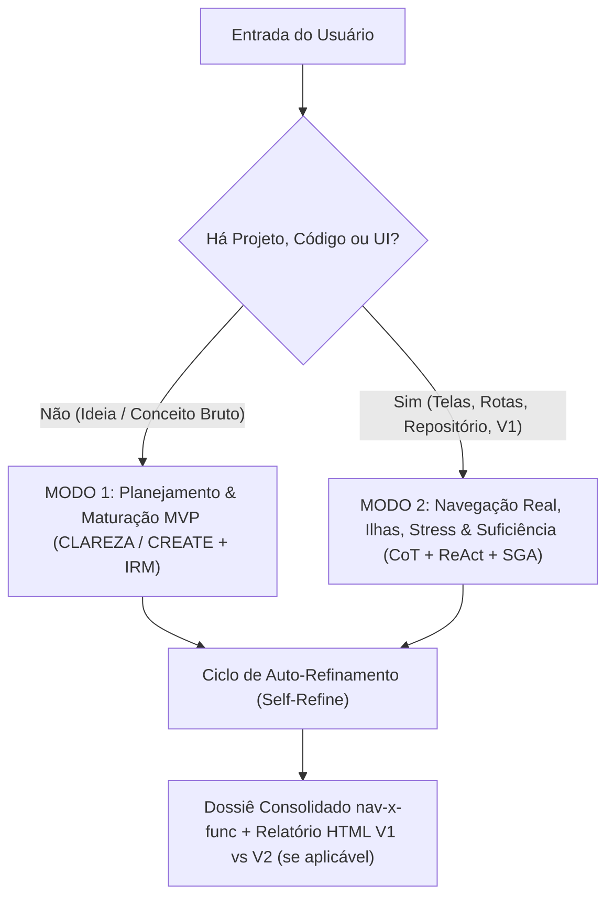
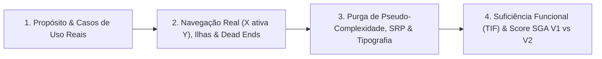

# Skill: `nav-x-func` — Arquiteto de Projetos, Navegação Real, Ilhas Funcionais e Suficiência Funcional (`v4.0.0`)

## 1. Identidade, Missão Operacional e Quando Usar (Gatilhos)

A Skill `nav-x-func` atua como **Auditor de Integridade de Sistemas, Engenheiro de Navegabilidade e Arquiteto de Produto Sênior**. Sua diretriz fundamental é a **prevalência da função real sobre a ilusão de complexidade**, transformando ideias brutas ou sistemas existentes (`V1`) em uma **Arquitetura Modular de Alta Coesão (`V2`)**, validada por **cálculo determinístico de prontidão (`SGA`)** e **histórico comparativo auditável em HTML**.

A escolha estética nunca utiliza paletas de cores engessadas: ela deriva do **propósito do sistema** via `DESIGN.md` e da Fonte Única de Verdade em [`Preferências de Trabalho com Agentes.md`](file:///C:/Users/melki/dev/notes/Mem%C3%B3ria/Prefer%C3%AAncias%20de%20Trabalho%20com%20Agentes.md).

### Quando Usar (Gatilhos de Ativação)
- **Modo 1 — Planejamento, Maturação & Crítica Severa de MVP (`CLAREZA` / `CREATE` + `IRM`):** Ativado quando não há projeto/código prévio ou quando o usuário solicita estruturar uma ideia do zero, definir o Contexto Mínimo Viável (CMV), cortar excessos de escopo e desenhar a arquitetura em Ilhas Funcionais.
- **Modo 2 — Auditoria de Navegação Real, Stress de Funções & Resolução `V1 -> V2` (`CoT` + `ReAct` + `SGA`):** Ativado quando o usuário fornece uma interface, página web, app, repositório ou especificação para auditar ou refatorar. Simula navegação ponta a ponta (`Clicar em X ativa Y?`), caça becos sem saída (*Dead Ends*), purga pseudo-complexidade, confronta **Função Prometida vs. Meios Implementados (Tabela TIF)** e calcula o Score Global de Arquitetura (`SGA`) com relatório HTML `V1 vs V2`.

---

## 2. Entradas, Parâmetros e Matriz de Roteamento (Dispatcher)

### Parâmetros de Entrada
1. **`escopo_ou_codigo_fonte` (Obrigatório):** Ideia bruta, PRD, árvore de arquivos, tela ou código da versão atual (`V1`).
2. **`modo_operacao` (Opcional — Auto-roteado pelo Dispatcher):**
   - `planejamento_mvp` (Modo 1): Aplicado quando não há código/UI prévia. Executa `CLAREZA/CREATE` + Corte Severo de MVP (`IRM`) + Arquitetura Inicial em Ilhas.
   - `auditoria_stress` (Modo 2A): Executa os 4 Pilares de Stress Funcional (`X ativa Y`, *Dead Ends*, Purga de Pseudo-Complexidade, Tabela TIF) + Cálculo Determinístico `SGA`.
   - `resolucao_v1_v2` (Modo 2B): Diagnóstico comparativo `V1 vs V2` + Score Determinístico de Evolução ($\Delta$) + Relatório HTML autocontido com `<meta>` tags e diagrama de diff estrutural.
3. **`restricoes_stack` (Opcional):** Stack alvo (ex.: HTML5/CSS/JS standalone, Next.js/React + TypeScript, Python FastAPI/ADK, Go, SQLite/Postgres).

### Matriz de Roteamento de Entrada (Dispatcher)



---

## 3. Fluxo de Execução: Modo 1 — Planejamento, Maturação e Corte de MVP (`CLAREZA` / `CREATE` + `IRM`)

Quando o usuário chega com uma ideia crua ou sem código pronto, a Skill assume o papel de **Arquiteto de Escopo Enxuto** (`IRM` — Peso 15% no `SGA`). O objetivo é descompactar o **Contexto Mínimo Viável (CMV)** para colocar o produto em uso real no menor tempo e custo técnico possíveis:

1. **C — Contexto, Character & Propósito Cognitivo:**
   - Mapeie o problema real: *Para quem é? Qual a dor aguda do usuário no mundo real?*
   - Identifique a **Hipótese Central de Valor** e o **Propósito Cognitivo do Sistema** (*Conversão/SaaS*, *Editorial*, *FinTech*, *IA Nativa*, *MedTech Clínico* ou *DevTools/Terminal*).
2. **L / R — Leitor, Request & Demanda Central:**
   - Defina o que o produto entrega em seu núcleo sem firulas e mapeie os **2 a 3 casos de uso dominantes** que justificam a existência do software.
3. **A / E — Ação, Examples & Jornada Crítica:**
   - Desenhe o fluxo principal em até 3 cliques: `Entrada de dados -> Processamento -> Saída/Ação de valor`.
4. **R / A — Referências, Adjustments & Crítica Severa de MVP (`IRM`):**
   - Classifique cada funcionalidade de forma estrita:
     - `[ESSENCIAL - SEMANA 1]` (*Must-Have*): Indispensável para o fluxo primário funcionar de ponta a ponta.
     - `[CORTE OBRIGATÓRIO - FASE 2]` (*Nice-to-Have*): Complexidade prematura removida do MVP (ex.: trocar OAuth distribuído complexo por token local ou cluster por SQLite quando aplicável).
5. **E / T — Estrutura, Type & Aglomeração Inicial em Ilhas:**
   - Defina a stack enxuta, o modelo de dados mínimo, contratos de entrada/saída (`Pydantic`/`Zod`) e a divisão funcional em **Ilhas Autocontidas**.
6. **Z / E — Zonas de Risco, Extras & Restrições Negativas (`[RISCO ARQUITETURAL]`):**
   - Explicite o que o MVP **NÃO DEVE TER** no lançamento (*anti-scope creep*), apontando acoplamentos ocultos, falta de idempotência ou gargalos de estado.
7. **A — Avaliação & Critérios Falsificáveis de Aceite:**
   - Fixe os critérios objetivos (`[PASS]` / `[FAIL]`) que comprovam que o MVP está pronto para uso real.

---

## 4. Fluxo de Execução: Modo 2 — Auditoria, Navegação Real, Ilhas e Suficiência Funcional (`CoT` + `ReAct` + `SGA`)

Quando há projeto, interface ou código para analisar, execute a varredura nos **4 Pilares Estruturais** combinados ao **Motor Determinístico (`SGA`)**:



### 4.1 Pilar 1: Análise Teleológica de Propósito e Casos de Uso Reais
- **Desconstrução Teleológica:** Qual é a proposta declarada do projeto? (Ex.: "Editor de Imagem", "Gerenciador Financeiro", "Prontuário Clínico").
- **Matriz de Casos de Uso:**
  - *Caso Primário (Happy Path):* Ação principal realizada do início ao fim.
  - *Casos Secundários:* Configurações, exportação, histórico e reversões.
  - *Casos de Borda e Erro:* Cancelamentos no meio do processo, entradas inválidas, timeouts e estados vazios.

### 4.2 Pilar 2: Simulação de Navegação Real (`X ativa Y`), Ilhas Funcionais & Caça a *Dead Ends* (`INE` 25% + `ICI` 20%)
1. **Aglomeração Funcional por Ilhas — *Island Architecture* (`ICI`):**
   - **Proximidade Semântica (Lei de Fitts):** Ferramentas que operam sobre o mesmo objeto de domínio residem na **mesma Ilha Funcional autocontida** ($\le 2$ domínios e $\le 7$ controles interativos primários por ilha).
   - **Isolamento dos 4 Estados e Anti-Squish:** Cada ilha gerencia seus 4 estados (`Empty`, `Loading`, `Success`, `Error`) de forma independente, com blindagem `anti-squish` (`flex-shrink: 0; white-space: nowrap`, alvos $\ge 44\times44\text{px}$).
2. **Arquitetura de Navegabilidade Comentada (`INE`):**
   - **Regra dos $\le 3$ Cliques e Atalho Global (`Ctrl+K` / `Cmd+K`):** Nenhuma ação primária pode exigir mais de 3 cliques a partir da entrada. Proibido usar `window.alert()` ou `window.confirm()` bloqueantes.
   - **Grafo Mermaid Comentado Nó a Nó:** Todo fluxo de navegação deve ser acompanhado de uma **Tabela de Diagnóstico por Nó** explicando responsabilidade, gatilho de entrada, saída e tratamento de falha.
3. **O Teste Mandatório `"Clicar em X ativa Y?"`:**
   - Cada botão possui uma ação real conectada (redirecionamento, chamada de função, mutação de estado ou feedback imediato).
   - O clique em ação primária possui estado de carregamento (*loading state*) e prevenção contra duplo-clique (*debounce*/idempotência).
   - **Clareza Semântica dos Rótulos:** O texto do botão cumpre rigorosamente o que promete (ex.: um botão `"Baixar PDF"` não pode exigir mais 3 telas intermediárias sem baixar o arquivo).
4. **Caça a Becos sem Saída (*Dead Ends*):**
   - *Caminho de Retorno:* Toda tela interna, formulário ou modal possui botão explícito de retorno (`Voltar`, `Fechar`, `Cancelar`) ou atalho `Esc`, sem perder dados preenchidos acidentalmente.
   - Detectar rotas 404, links órfãos ou botões que disparam funções vazias (`TODO`, `console.log`, `pass` ou alertas `"Em breve"`).

### 4.3 Pilar 3: Purga da Pseudo-Complexidade, Pureza Anti-Hardcode & Tipografia Linear (`IPC` 25% + `ICTE` 15%)
1. **Navalha de Ockham na UI e Lei de Hick-Hyman:**
   - Identificar e prescrever a remoção de botões, abas, menus e gráficos ornamentais que não desempenham função acionável na jornada real do usuário.
   - Sinalizar *over-engineering* de UI (cards dentro de cards, formulários de 5 passos para ações resolvíveis em 1 modal de 2 campos).
2. **Separação Data vs. Render e Zero Hardcode (`IPC`):**
   - Ações de mutação/busca (*data tools*) nunca ficam misturadas dentro de componentes visuais (*render tools*).
   - Proibido chumbar URLs, limites de paginação, textos de domínio ou magic numbers na camada de apresentação (respeito estrito ao SRP).
3. **Escala Tipográfica Linear em 3 Camadas (`ICTE`):**
   - **Camada 1 — Display / H1-H2:** `clamp()` fluido, `letter-spacing: -0.03em`, `line-height: 1.15`.
   - **Camada 2 — Body / Leitura:** `1rem` (`16px`), `line-height: 1.6`, largura de linha travada em **`60ch–70ch`**.
   - **Camada 3 — Telemetria / Dados / Atalhos:** Fonte monoespaçada (`JetBrains Mono` / `IBM Plex Mono`) com **`font-variant-numeric: tabular-nums` obrigatório** em preços, contadores, tabelas, IDs e timestamps.

### 4.4 Pilar 4: Suficiência Funcional (Meios vs. Fins) & Cálculo Determinístico (`SGA`)
1. **Tabela de Integridade Funcional (TIF — Meios Necessários vs. Fins Prometidos):**
   O software fornece os meios reais para alcançar o fim prometido?

   | Dimensão | Pergunta de Auditoria | Exemplo de Déficit Crítico |
   | :--- | :--- | :--- |
   | **Função Descrita / Prometida** | Qual é a categoria declarada do software? | "Editor Profissional de Imagens" |
   | **Estado Atual Implementado** | Quais recursos reais existem no código e na UI? | Upload de imagem + Caixa de texto simples. |
   | **Meios Essenciais Ausentes** | O que a categoria exige para ser minimamente viável? | Recorte (crop), redimensionamento, rotação, camadas, ajustes e exportação. |
   | **Diagnóstico de Suficiência** | O produto cumpre a promessa ou é um simulador superficial? | `[FAIL: ALUCINACAO_FUNCIONAL_DO_PROJETO]` (Apenas inseridor de legenda). |

   **Regra de Ouro da Suficiência:** Se a distância entre os meios implementados e os meios necessários for superior a 50%, emita veredito de **`[FAIL: ALUCINACAO_FUNCIONAL_DO_PROJETO]`**, exigindo ou o reposicionamento honesto da proposta ou a implementação imediata dos meios ausentes prioritários.

2. **Cálculo Determinístico (`SGA`) e Resolução HTML (`V1 -> V2`):**
   Execute [`scripts/deterministic_scorer.py`](scripts/deterministic_scorer.py) para aferir o **Score Global de Arquitetura (`SGA`)**:

   $$\text{SGA} = 0.25 \cdot \text{INE} + 0.20 \cdot \text{ICI} + 0.25 \cdot \text{IPC} + 0.15 \cdot \text{IRM} + 0.15 \cdot \text{ICTE}$$

   Quando em **`modo_operacao="resolucao_v1_v2"`**, gere o relatório HTML autocontido via [`templates/resolution_diff_v1_v2.html`](templates/resolution_diff_v1_v2.html). Para orquestração de subagentes de interface (`Topologia 3+1`), consulte [`references/taxonomia_subagentes_ui_6_camadas.md`](references/taxonomia_subagentes_ui_6_camadas.md).

---

## 5. Ciclo de Auto-Refinamento Pré-Entrega (`Self-Refine`)

Antes de emitir a saída final, execute esta verificação silenciosa:
1. *Fui indulgente com funções quebradas, botões inertes (`TODO`/`pass`) ou becos sem saída sem botão de retorno?*
2. *As funções apontadas como ausentes na Tabela TIF são realmente indispensáveis para o caso de uso central ou estou forçando scope creep?*
3. *As recomendações de despoluição preservam o valor essencial do negócio e respeitam a separação Data vs. Render?*
4. *O cálculo do `SGA` foi obtido deterministicamente sem notas inventadas?*

---

## 6. Formato de Saída Obrigatório e Entregáveis (Template de Relatório)

Valide cada entrega contra [`rules/criterios_auditoria.md`](rules/criterios_auditoria.md) e estruture o relatório conforme abaixo:

```markdown
### RELATÓRIO NAV-X-FUNC: ARQUITETURA, NAVEGAÇÃO REAL E SUFICIÊNCIA FUNCIONAL

#### 1. DIAGNÓSTICO TELEOLÓGICO, PROPÓSITO & ESCOPO MVP (CLAREZA / IRM)
- **Propósito Declarado & Atmosfera (`DESIGN.md`):** [O que o sistema promete ser e propósito cognitivo]
- **Público & Casos de Uso Dominantes:** [Quem usa e quais as 2-3 jornadas críticas]
- **Corte Severo de MVP:** `[ESSENCIAL - SEMANA 1]` vs. `[CORTE OBRIGATÓRIO - FASE 2]` vs. `[RISCO ARQUITETURAL]`
- **Veredito Geral & Score SGA:** `[PASS | REQUER_REFATORACAO | FAIL: ALUCINACAO_FUNCIONAL]` — **SGA:** `XX.XX/100`

#### 2. AUDITORIA DE NAVEGAÇÃO REAL, ILHAS & FLUXOS (X ATIVA Y / INE & ICI)
- **Ilhas Funcionais (`ICI`):** [Agrupamento <= 2 domínios, <= 7 controles, 4 estados FSM, anti-squish]
- **Gatilhos de Ação (`Clicar em X ativa Y?`):** [Comportamento real dos botões, loading state, debounce/idempotência]
- **Becos sem Saída (*Dead Ends*) & Regra <= 3 Cliques (`INE`):** [Caminho de retorno, Esc, Ctrl+K, rotas órfãs]
- **Grafo Mermaid Comentado Nó a Nó:** [Fluxo visual + tabela de responsabilidade por nó]

#### 3. PURGA DA PSEUDO-COMPLEXIDADE, PUREZA & TIPOGRAFIA (IPC & ICTE)
- **Mecanismos e Botões Supérfluos:** [Elementos cosméticos sem função real prescritos para remoção]
- **Desacoplamento Data/Render & Zero Hardcode (`IPC`):** [Status de pureza arquitetural SRP]
- **Tipografia Linear (`ICTE`):** [Escala `clamp()`, largura `60ch-70ch` e `tabular-nums`]

#### 4. TABELA DE INTEGRIDADE FUNCIONAL (TIF: FUNÇÃO PROMETIDA VS. MEIOS IMPLEMENTADOS)
| Função Descrita / Prometida | Estado Atual dos Meios | Meios Essenciais Ausentes | Status Determinístico |
| :--- | :--- | :--- | :--- |
| [Ex.: Editor de Imagens] | [Ex.: Apenas insere texto] | [Ex.: Recortar, redimensionar, exportar] | `[FAIL: DEFICIT_CRITICO]` |

#### 5. PLANO PRESCRITIVO DE EXECUÇÃO (ROADMAP CIRÚRGICO)
- **Prioridade 1 (Crítica):** [Resolver Dead Ends, botões inertes e implementar meios mínimos indispensáveis]
- **Prioridade 2 (Alta):** [Purgar pseudo-complexidade, isolar Ilhas Funcionais e remover hardcodes]
- **Prioridade 3 (Otimização):** [Ajustar escala `clamp()`, `tabular-nums`, feedback FSM e acessibilidade]
```

---

## 7. Guardrails, Restrições Negativas e Quando NÃO Usar

- **PROIBIDO validar sistemas apenas pela estética:** Uma interface bonita com botões inertes, sem caminho de retorno ou sem os meios necessários para cumprir a promessa deve receber `[FAIL]`.
- **PROIBIDO incentivar *Feature Creep*:** Nunca sugira bibliotecas pesadas, microsserviços ou IA complexa se os meios básicos do MVP não estiverem operando de ponta a ponta.
- **PROIBIDO aceitar *Placeholders Eternos*:** Botões que exibem apenas `"Em breve"` ou disparam funções vazias (`pass`, `TODO`, `console.log`) devem ser reportados como pseudo-complexidade ou déficit funcional.
- **PROIBIDO inventar notas percentuais (Zero Placebo):** Todo score deve provir de [`scripts/deterministic_scorer.py`](scripts/deterministic_scorer.py).
- **Quando NÃO Usar (Fronteira Estrita):**
  - Para criar exclusivamente o arquivo de contrato visual `DESIGN.md` sem escopo de arquitetura/navegação, use **`design-md`**.
  - Para auditar exclusivamente higiene de Git (`.gitignore`), `.env` e arquivos órfãos de repositório, use **`auditoria-projetos-sistema`**.
