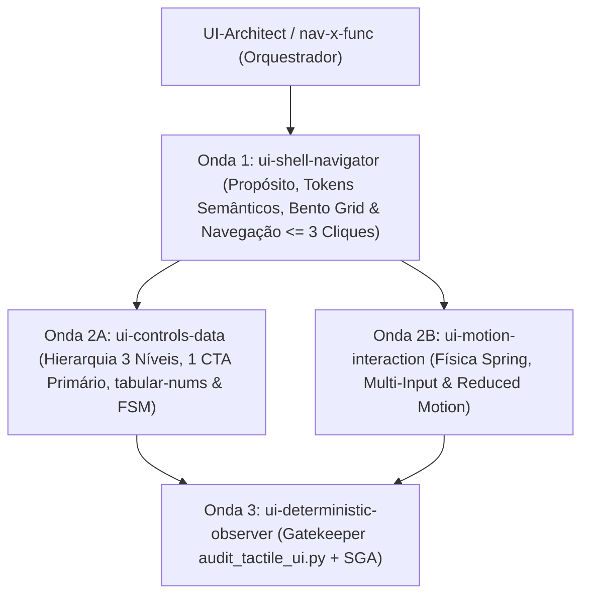

# Taxonomia de Subagentes Especialistas de UI/UX (`Topologia 3+1` — `v4.0.0`)

Mapeia a correspondência entre as 6 dimensões arquiteturais de UI/UX e a **Topologia Enxuta 3+1** (`ui-shell-navigator`, `ui-controls-data`, `ui-motion-interaction` e `ui-deterministic-observer`) coordenada por **`UI-Architect`**, aplicando as diretrizes da Fonte Única de Verdade em [`Preferências de Trabalho com Agentes.md`](file:///C:/Users/melki/dev/notes/Mem%C3%B3ria/Prefer%C3%AAncias%20de%20Trabalho%20com%20Agentes.md).

---

## 1. Consolidação das 6 Dimensões na Topologia 3+1

| Agente Canônico (`agents/`) | Onda | Dimensões Absorvidas | Responsabilidade Arquitetural |
| :--- | :---: | :--- | :--- |
| **`ui-shell-navigator`** | Onda 1 | Fundações & Tokens + Layout Bento & Navegação | Seleção da atmosfera pelo propósito do projeto via `DESIGN.md` (tokens semânticos sem cores travadas), Bento Grid 12 colunas (`CLS < 0.1`), espaçamento ($\ge 25\%$ respiro), raios concêntricos e navegação (`Ctrl+K`, $\le 3$ cliques, caminho de retorno sem *Dead Ends*). |
| **`ui-controls-data`** | Onda 2A | Controles Interativos + Dados & Feedback | Hierarquia visual em 3 níveis (Squint Test), equilíbrio de acento 90/8/2 (1 CTA primário sólido vs `.btn-ghost`), `tabular-nums`, alvos $\ge 44\times44\text{px}$, blindagem `anti-squish` e estados FSM (`idle`, `loading`, `error`, `empty`, `pressed`). |
| **`ui-motion-interaction`** | Onda 2B | Física de Movimento & Multi-Input | Curvas elásticas (`--ease-spring: cubic-bezier(0.22, 1, 0.36, 1)`), transições suaves de camada, suporte multi-input (Mouse, Touch, Pen, Keyboard), `:focus-visible` e `@media (prefers-reduced-motion: reduce)`. |
| **`ui-deterministic-observer`** | Onda 3 | Gatekeeper Determinístico (`frontend-testing-auditor` v4.0) | Executa `scripts/audit_tactile_ui.py` + `deterministic_scorer.py`, valida `AUDIT-A11Y-01/02`, `AUDIT-VIS-01`, `AUDIT-VIS-EMOJI`, `AUDIT-VIS-BLOAT`, `AUDIT-STATE-01` e `AUDIT-SEC-01`. |

---

## 2. Topologia de Execução (`plans/ui_composition_dag.json`)

