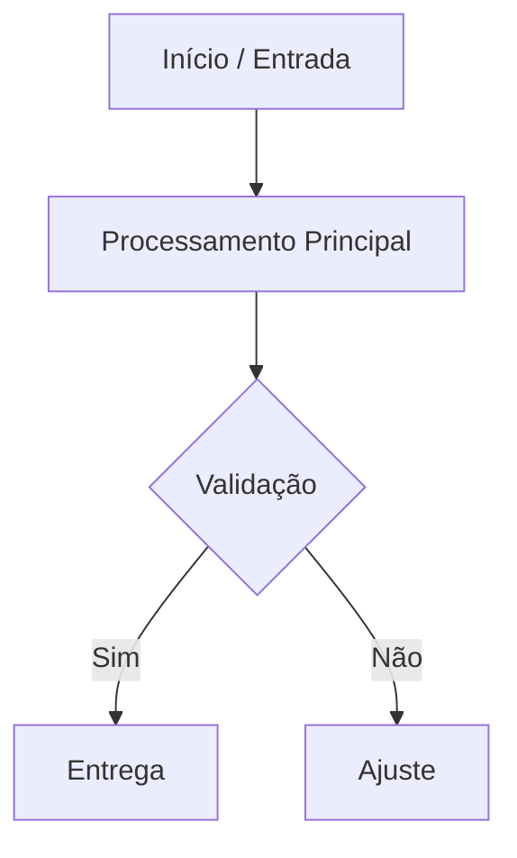

# Organizador de Ideias em Fluxo Mermaid e Árvore de Arquivos (`organizador-fluxo-arvore-arquivos`)

## 1. Propósito e Gatilhos de Ativação (Quando Usar)

- Converter rascunhos de apps, ideias ou fluxos operacionais em diagramas `mermaid` (`flowchart TD`/`LR`) e árvores de diretórios comentadas.
- Gerar histórico incremental de versões e exportar a arquitetura diretamente em `.md` ou `.pdf`.

### Quando NÃO Usar

- Para auditar segurança estática AST de código existente (use `code-acceptability-auditor` ou `auditoria-projetos-sistema`).
- Para implementar código completo de produção (foco restrito a fluxo lógico, etapas e estrutura de pastas).

---

## 2. Entradas Esperadas e Pré-requisitos

- `idea_text` (obrigatório): Texto bruto do pedido ou especificação do usuário.
- `previous_output` (opcional): Versão anterior para cálculo de delta no histórico semântico.
- `export_format` (opcional): `chat` (padrão), `md` ou `pdf`.

---

## 3. Processo Passo a Passo (Fases, Coerência Lógica e Fase 0)

1. **Fase 0 — Gestão de Ambiguidade e Captura Literal**:
   - Preservar o texto exato do usuário em `Pedido original` (proibido resumir ou reescrever).
   - Se faltarem premissas essenciais, registrar `[LACUNA]` explícita e formular no máximo 1–2 perguntas objetivas (HITL) sem inventar escopo.
2. **Divisão em Fases, Dependências e Escopo MVP**:
   - Ordenar o fluxo em etapas sequenciais com coerência lógica e dependências explícitas entre entrada, processamento e saída.
   - Isolar apenas os módulos vitais ao MVP; segregar extras em `Sugestões Opcionais`.
3. **Diagramação Mermaid e Árvore Comentada**:
   - Aplicar aspas duplas em rótulos com caracteres especiais e comentar cada arquivo/pasta da árvore conforme [`references/padroes_mermaid_e_arvore.md`](references/padroes_mermaid_e_arvore.md).
4. **Exportação Direta (`.md` ou `.pdf`)**:
   - Salvar em `.md` com `write_file` ou exportar `.pdf` delegando a [`../conversor-html-pdf/SKILL.md`](../conversor-html-pdf/SKILL.md) (`../../scripts/md-to-pdf.ps1`) quando solicitado.

---

## 4. Saídas e Entregáveis (Template Estruturado)

Validar cada entrega contra [`rules/criterios_auditoria.md`](rules/criterios_auditoria.md):

````text
arquivo: [ex: arquitetura_app_v1.md]
nome: [Nome da Solução]
função: [Objetivo principal em 1 frase]
versão: [X.Y.Z] | data: [YYYY-MM-DD]

============================================================
Pedido original:
"[Texto literal fornecido pelo usuário]"
============================================================

fluxo de organização (etapas e dependências):
1. [Fase 0 / Entrada]
2. [Processamento / Decisão]
3. [Saída / Entregável]

### 1. Histórico de Alterações
- v1.0.0 ([YYYY-MM-DD]): Estruturação inicial.

### 2. Diagrama de Fluxo Visual (Mermaid)


### 3. Estrutura e Árvore de Arquivos
```text
meu-projeto/
├── src/                # Módulos principais do MVP
│   └── main.py         # Ponto de entrada e orquestração
├── tests/              # Testes automatizados
└── README.md           # Guia rápido de execução
```

### 4. Modo de Execução Recomendado
- Etapa 1: ...
- Etapa 2: ...

### 5. Sugestões Opcionais (Fora do MVP)
- [Melhoria opcional desacoplada]

### 6. Opção de Exportação (.md / .pdf)
- Deseja salvar em arquivo `.md` no workspace ou exportar em `.pdf` via `conversor-html-pdf`?
````

---

## 5. Guardrails de Segurança e Limites

- **Escopo Fechado (Anti-Bloat)**: Proibido alterar o `Pedido original` ou inflar o MVP com serviços não pedidos.
- **Zero Segredos & HITL**: Usar apenas `.env.example` nas árvores propostas e pedir confirmação humana antes de sobrescrever arquivos existentes no workspace.
