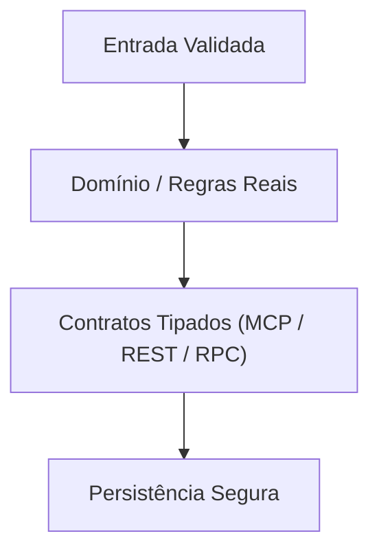

# SKILL: `organizador-projetos-ideias` — Ideação, Análise Holística, Estrutura Ideal e MVP Funcional Seguro (`v1.2.0`)

## 1. OBJETIVO, PROPÓSITO E GATILHOS DE USO

Atua como **Arquiteto de Produto e Engenheiro de Repositórios**, operando em dois modos complementares sob as melhores práticas vigentes (`2026`):

1. **Modo 1 — Concepção e Ideação (`ideation_to_v1`)**: Converte uma ideia bruta em um **MVP real, funcional e seguro desde a base**, guiando perguntas estratégicas (com protocolo inteligente para *"não sei"*), benchmarking em repositórios de referência, definição da árvore modular ideal e geração de arquivos iniciais **pré-preenchidos com código básico funcional e guardrails de segurança** (`v1.0.0`).
2. **Modo 2 — Análise Holística e Reorganização de Projeto (`project_organizer_sync`)**: Mapeia a estrutura atual do disco, analisa o conteúdo como um todo e a intenção real do sistema, pesquisa projetos similares de referência, projeta a **estrutura ideal explicando o papel de cada arquivo**, pré-preenche módulos faltantes com código funcional/seguro, sincroniza a Tríade de Governança (`AGENTS.md`, `.context/context.md`, `.context/spec.md`, `DESIGN.md`, `README.md` 1:1 com o disco) e organiza contratos (`MCP tools.json`, `FastAPI`, `JSON-RPC 2.0`).

---

## 2. ENTRADAS, PARÂMETROS E MODOS DE ATIVAÇÃO

- **MODO 1 (`ideation_to_v1`)**: Acionado em diretórios vazios ou pedidos de *"refinar uma ideia / criar MVP do zero"*. Entradas: rascunho da ideia, objetivo central e respostas às perguntas guiadas (1 a 3 por rodada).
- **MODO 2 (`project_organizer_sync`)**: Acionado em repositórios existentes (*"organize meu projeto / estruture este repositório"*). Entradas: `project_root`, manifestos (`pyproject.toml`, `package.json`, `go.mod`), código-fonte e histórico Git.

---

## 3. FLUXO OPERACIONAL PASSO A PASSO

### FLUXO DO MODO 1: Ideação até a `v1.0.0` Funcional e Segura (`ideation_to_v1`)

1. **Triagem de Intenção, Resultado e Foco (`1 a 3 perguntas`)**: Ancore qual problema real o projeto resolve, qual resultado prático entrega e qual o recorte da primeira entrega.
2. **Definição do MVP Funcional e Seguro (Protocolo *"Não sei"*)**:
   - Se o usuário responder *"não sei"* sobre as funções, proponha imediatamente o pacote mínimo indispensável com **execução real e segurança nativa** (validação estrita de entrada, variáveis de ambiente protegidas, tratamento de erros acionável — **proibido MVP casca vazia ou funções placebo**).
3. **Benchmark de Referência e Árvore Modular Ideal**:
   - Pesquise padrões de projetos similares em **repositórios de referência/premium** da mesma stack (GitHub / docs oficiais) para adotar convenções maduras.
   - Monte a árvore ideal explicando **exatamente o que entra em cada pasta e arquivo**.
4. **Bootstrap Pré-Preenchido (`v1.0.0` sob confirmação)**:
   - Crie pastas, Tríade de Governança (`.agents/AGENTS.md`, `.context/context.md`, `.context/spec.md`), `.gitignore`, `.env.example` e **arquivos iniciais já pré-preenchidos com código básico funcional, tipagem estrita e práticas de segurança** + metadados datados (`AAAA-MM-DD`).

### FLUXO DO MODO 2: Mapeamento Atual, Benchmark e Estrutura Ideal (`project_organizer_sync`)

1. **Mapeamento da Estrutura Atual e Análise Holística de Intenção**:
   - Mapeie a árvore física atual, manifestos, entrypoints e contratos; leia o conteúdo como um todo para extrair a **intenção real do sistema** (fazendo até 3 perguntas pontuais se houver `[LACUNA]` arquitetural).
2. **Pesquisa de Similares de Referência e Desenho da Estrutura Ideal**:
   - Compare o projeto com **repositórios de referência/premium** equivalentes na stack ativa para definir a **Estrutura Ideal**, detalhando o que vai dentro de cada diretório/módulo e o plano de migração sem quebrar imports.
3. **Pré-Preenchimento Funcional, Segurança e Diagrama Mermaid**:
   - Para módulos ou contratos faltantes do MVP, gere arquivos **pré-preenchidos com código básico funcional, validação de fronteira (`Pydantic v2 extra="forbid"` / `Zod .strict()` / structs Go) e proteção de segredos** (zero stubs vazios).
   - Gere diagrama `flowchart TD` ou `sequenceDiagram` (rótulos entre aspas) refletindo o fluxo real.
4. **Sincronização de Documentos-Chave e Contratos (`MCP`, `FastAPI`, `RPC`)**:
   - Sincronize `AGENTS.md`, `.context/spec.md` (`SPEC.md`), `.context/context.md` (`CONTEXT.md`), `DESIGN.md` e reescreva o `README.md` com **paridade 1:1 contra o disco real** (consulte [`references/guia_contratos_mcp_fastapi_rpc_e_documentos.md`](references/guia_contratos_mcp_fastapi_rpc_e_documentos.md)).
   - Quando o projeto usar Gemini API ou WebSockets/JSON-RPC, valide modelos vigentes (`gemini_search_docs`) e contratos em `contracts/` conforme [`../agent-server-auditor/references/audit-websocket-jsonrpc.md`](../agent-server-auditor/references/audit-websocket-jsonrpc.md).
5. **Higiene Segura da Raiz (`Dry-Run`)**:
   - Liste rascunhos/scripts órfãos na raiz e, somente após aprovação humana, realoque-os para `scripts/`, `docs/` ou `tests/`, atualizando `.context/context.md` (`CONTEXT.md`).

---

## 4. FORMATO OBRIGATÓRIO DE SAÍDA E ENTREGÁVEIS

````markdown
# METADADOS DO PROJETO E VERSÃO
- **Projeto:** `<Nome>` | **Modo:** `<Modo 1 | Modo 2>` | **Versão:** `<vX.Y.Z>` | **Data:** `<AAAA-MM-DD>`
- **Segurança Base (`.env.example` / `.gitignore` / Schemas Estritos):** `[OK | Ajustado]` | **Git Remote:** `<URL | Pendente>`

## 1. ANÁLISE DE INTENÇÃO, CONTEÚDO GLOBAL E MVP FUNCIONAL SEGURO
- **Intenção Central & Referências Analisadas:** `<Problema resolvido + padrões de referência aplicados>`
- **Escopo Real do MVP (Funcional + Segurança Embutida):**
  - [ ] `<Módulo/Função 1>` — `<Comportamento executável real + validação/segurança>`

## 2. DIAGRAMA DE FUNCIONAMENTO (MERMAID)


## 3. MAPEAMENTO ATUAL VS. ESTRUTURA IDEAL COM PAPEL DE CADA ARQUIVO
- **Diagnóstico da Estrutura Atual:** `<Resumo dos gargalos, arquivos órfãos ou lacunas encontrados>`
```text
projeto/
├── .agents/AGENTS.md        # Governança, stack auto-detectada e comandos executáveis
├── .context/                # context.md (estado vivo) e spec.md (contrato técnico e I/O)
├── src/
│   ├── api/                 # Rotas tipadas, middlewares de auth/erro e GET /health
│   ├── domain/              # Lógica de negócio real (pré-preenchida, zero placebo)
│   └── contracts/           # Schemas estritos, tools.json (MCP) e métodos JSON-RPC 2.0
├── tests/                   # Testes determinísticos (happy-path + caso adversarial)
├── .env.example             # Chaves necessárias documentadas sem segredos reais
├── .gitignore               # Bloqueio de .env, ambientes virtuais e builds
└── README.md                # Documentação 100% espelhada nos arquivos reais do disco
```
- **Arquivos Pré-Preenchidos e Contratos Sincronizados:** `<Lista com resumo do código base + segurança aplicado>`

## 4. PRÓXIMO PASSO INTERATIVO
- `<Confirmação objetiva para materializar a v1.0.0 ou aplicar a reorganização física com Dry-Run>`
````

---

## 5. LIMITES, EXCEÇÕES E GUARDRAILS (QUANDO NÃO USAR)

- **Proibido MVP Oco ou Limpeza Destrutiva sem `Dry-Run`**: Nunca entregue arquivos vazios/`TODO` como MVP nem mova/remova arquivos da raiz sem aprovação explícita conforme [`rules/criterios_auditoria.md`](rules/criterios_auditoria.md).
- **Zero Vazamento de Segredos**: Jamais copie valores reais de `.env` para `README.md`, `SPEC.md` ou `CONTEXT.md`.
- **Fronteira Limpa**:
  - Para auditoria quantitativa (`0–100`), chunking AST, diagnóstico *Read-Only* de MVP em 3 fases e DOM via `agent-browser` (`@eX`), use [`../auditoria-projetos-sistema/SKILL.md`](../auditoria-projetos-sistema/SKILL.md).
  - Para mapear apenas fluxos visuais/árvores documentais em Markdown/PDF sem mutar o repositório, use [`../organizador-fluxo-arvore-arquivos/SKILL.md`](../organizador-fluxo-arvore-arquivos/SKILL.md).
