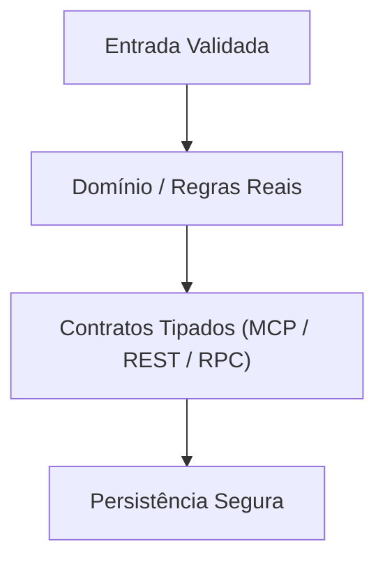

# Template de Entrega, Diagrama Mermaid & Árvore Ideal (`organizador-projetos-ideias`)

Complemento detalhado de [`SKILL.md`](../SKILL.md). Consulte também [`guia_contratos_mcp_fastapi_rpc_e_documentos.md`](guia_contratos_mcp_fastapi_rpc_e_documentos.md).

````markdown
# METADADOS DO PROJETO E VERSÃO
- **Projeto:** `<Nome>` | **Modo:** `<Modo 1 | Modo 2>` | **Versão:** `<vX.Y.Z>` | **Data:** `<AAAA-MM-DD>`
- **Segurança Base (`.env.example` / `.gitignore` / Schemas Estritos):** `[OK | Ajustado]` | **Git Remote:** `<URL | Pendente>`

## 1. ANÁLISE DE INTENÇÃO, CONTEÚDO GLOBAL E MVP FUNCIONAL SEGURO
- **Intenção Central & Referências Analisadas:** `<Problema resolvido + padrões de referência aplicados>`
- **Escopo Real do MVP (Funcional + Segurança Embutida):**
  - [ ] `<Módulo/Função 1>` — `<Comportamento executável real + validação/segurança>`

## 2. DIAGRAMA DE FUNCIONAMENTO (MERMAID)


## 3. MAPEAMENTO ATUAL VS. ESTRUTURA IDEAL COM PAPEL DE CADA ARQUIVO
- **Diagnóstico da Estrutura Atual:** `<Resumo dos gargalos, arquivos órfãos ou lacunas encontrados>`
```text
projeto/
├── .agents/AGENTS.md        # Governança, stack auto-detectada e comandos executáveis
├── .context/                # context.md (estado vivo) e spec.md (contrato técnico e I/O)
├── src/
│   ├── api/                 # Rotas tipadas, middlewares de auth/erro e GET /health
│   ├── domain/              # Lógica de negócio real (pré-preenchida, zero placebo)
│   └── contracts/           # Schemas estritos, tools.json (MCP) e métodos JSON-RPC 2.0
├── tests/                   # Testes determinísticos (happy-path + caso adversarial)
├── .env.example             # Chaves necessárias documentadas sem segredos reais
├── .gitignore               # Bloqueio de .env, ambientes virtuais e builds
└── README.md                # Documentação 100% espelhada nos arquivos reais do disco
```
- **Arquivos Pré-Preenchidos e Contratos Sincronizados:** `<Lista com resumo do código base + segurança aplicado>`

## 4. PRÓXIMO PASSO INTERATIVO
- `<Confirmação objetiva para materializar a v1.0.0 ou aplicar a reorganização física com Dry-Run>`
````
