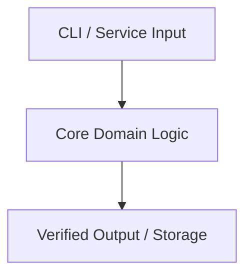

# Right-Sized Delivery Template (`project-idea-organizer` v1.3.0)

Output layout complementing `SKILL.md` and [`mcp_fastapi_rpc_contracts_guide.md`](mcp_fastapi_rpc_contracts_guide.md). Pick the layout proportional to the real scope—never emit empty folders or speculative protocol layers.

````markdown
# PROJECT METADATA & VERSION
- **Project:** `<Name>` | **Mode:** `<Mode 1 | Mode 2>` | **Scale:** `<Micro/CLI (1-4 files) | Service/App | Multi-Module>` | **Version:** `<vX.Y.Z>` | **Date:** `<YYYY-MM-DD>`
- **Security Baseline (`.gitignore` / `.env.example` if needed):** `[OK | Adjusted]` | **Git Remote:** `<URL | Pending>`

## 1. INTENT ANALYSIS & RIGHT-SIZED MVP SLICE
- **Core Problem Solved:** `<1–2 sentences anchored in real user goal>`
- **Runnable Vertical Slice (`v1.0.0`):**
  - [ ] `<Core Entrypoint / Feature>` — `<Input -> Real Logic -> Verifiable Output + 1 Test>`
- **Deferred (Post-MVP — NOT created on disk now):** `<Non-essential extras>`

## 2. OPERATIONAL FLOWCHART (Include ONLY when >= 3 runtime components interact)


## 3. CURRENT VS. TARGET STRUCTURE (WITH FILE ROLES)
- **Diagnosis / Parity Check:** `<Current disk state, preserved working imports, or Dry-Run root cleanup table>`

### Option A — Micro / Script / CLI (`1–4` source files, flat layout)
```text
project/
├── <app>.py                 # Complete runnable vertical slice + CLI args
├── tests/
│   └── test_<app>.py        # Happy-path + invalid-input tests
├── pyproject.toml           # Runtime dependencies and project metadata
├── .gitignore               # Ignores .env, .venv/, __pycache__/
└── README.md                # 1:1 setup and verified run commands
```

### Option B — Persistent Service / MCP / Multi-Module Repo (`>= 5` source files)
```text
project/
├── AGENTS.md                # Delta-only v2.1 repo rules and CLI checks (via bootstrap-project.ps1)
├── .context/
│   ├── context.md           # Authoritative project state, decisions, and backlog
│   └── spec.md              # Active scope lock and I/O contracts
├── <active_pkg>/            # Stack-native modules (only active protocols; >= 2 files per subfolder)
├── tests/                   # Automated tests (happy-path + adversarial boundary rejections)
├── .env.example             # Present only if env vars are used (zero real secrets)
├── .gitignore               # Credential and artifact ignores
└── README.md                # 1:1 mirror with real paths and verified commands
```

## 4. INTERACTIVE HITL NEXT STEP
- `<Confirmation prompt before writing v1.0.0 files or executing Dry-Run root moves>`
````
