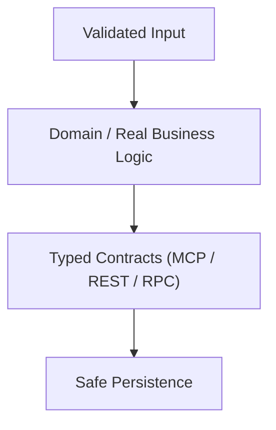

# Delivery Template, Mermaid Flowchart & Ideal Tree (`project-idea-organizer`)

Detailed output structure complementing [`SKILL.md`](../SKILL.md) and [`mcp_fastapi_rpc_contracts_guide.md`](mcp_fastapi_rpc_contracts_guide.md).

````markdown
# PROJECT METADATA & VERSION
- **Project:** `<Name>` | **Mode:** `<Mode 1 | Mode 2>` | **Version:** `<vX.Y.Z>` | **Date:** `<YYYY-MM-DD>`
- **Security Baseline (`.env.example` / `.gitignore` / Strict Schemas):** `[OK | Adjusted]` | **Git Remote:** `<URL | Pending>`

## 1. INTENT ANALYSIS, GLOBAL CONTEXT & SECURE FUNCTIONAL MVP
- **Core Intent & Benchmarked Patterns:** `<Problem solved + architectural patterns applied>`
- **Real MVP Scope (Executable + Embedded Security):**
  - [ ] `<Module/Feature 1>` — `<Real executable behavior + boundary validation>`

## 2. OPERATIONAL FLOWCHART (MERMAID)


## 3. CURRENT VS. IDEAL STRUCTURE MAPPING (WITH FILE ROLES)
- **Current State Diagnosis:** `<Summary of bottlenecks, root orphans, or missing modules>`
```text
project/
├── .agents/AGENTS.md        # Governance rules, auto-detected stack, and CLI commands
├── .context/                # context.md (live state) and spec.md (technical I/O contract)
├── src/
│   ├── api/                 # Typed routers, auth/error middleware, and GET /health
│   ├── domain/              # Real pre-filled business logic (zero placeholders)
│   └── contracts/           # Strict schemas, tools.json (MCP), and JSON-RPC 2.0 methods
├── tests/                   # Deterministic tests (happy-path + adversarial cases)
├── .env.example             # Documented environment variable keys without real secrets
├── .gitignore               # Ignores .env, virtualenvs, and build outputs
└── README.md                # Documentation mirrored 1:1 with real files on disk
```
- **Pre-Filled Starter Files & Synchronized Contracts:** `<Summary of generated baseline code and security checks>`

## 4. INTERACTIVE HITL NEXT STEP
- `<Clear confirmation prompt before creating v1.0.0 files or executing dry-run root moves>`
````
