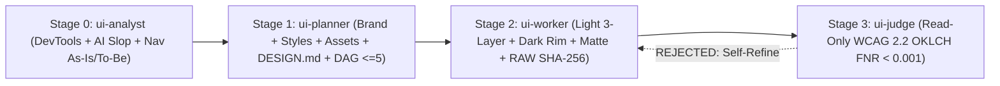

# Federated UI/UX Subagent Taxonomy (`shredded-shape` Actor-Critic 4-Stage Pipeline)

Frontend UI/UX architecture, optical physics, and Actor-Critic QA now live in the dedicated **`shredded-shape`** repository and plugin (`C:\Users\melki\dev\repos\shredded-shape`), orchestrated via `plans/ui_actor_critic_dag.json`:

---

## 1. The 4-Stage Actor-Critic Pipeline

| Subagent (`shredded-shape/agents/`) | Stage | Skill | Architectural Ownership |
| :--- | :---: | :--- | :--- |
| **`ui-analyst`** (`read-only`) | Stage 0 | `ui-frontend-analyst` | Inventories tokens, literal colors, typography, menus, navigation graph, imported icons, spacing defects, contracts, stack, live DevTools telemetry, AI Slop score, and `Before vs. After` route/sidebar refactoring proposals. |
| **`ui-planner`** (`read-only`) | Stage 1 | `ui-brand-ux-planner` | Diagnoses brand identity & `OKLCH 60-30-10` (zero neon), chooses 1 of 7 style archetypes (`Soft`, `Hi-Tech`, `Tactile`, `Elevated`, `Retro`, `Vintage`, `Clinical`), orchestrates Stitch/Figma/Google Fonts/3D assets, enforces zero-verbiage intuitive UX, and emits `DESIGN.md` + bounded `<= 5`-rule DAG. |
| **`ui-worker`** (`ReAct + RAW`) | Stage 2 | `ui-clean-worker` | Implements Light/Dark UIs with 3-layer `box-shadow` (light), specular rim + soft non-neon halo (dark), superior matte frosted surfaces, Single-DOM Adaptive Nav, real FSM, `workspace: "share"` vertical route ownership, and SHA-256 `Read-After-Write` verification. |
| **`ui-judge`** (`read-only`) | Stage 3 | `ui-quality-judge` | Enforces CIE 1931 $Y$ / OKLCH WCAG 2.2 contrast ($FNR < 0.001$), `48x48px` touch targets, `:focus-visible`, `DOM == Visual Order`, `prefers-reduced-motion`, anti-XSS, and anti-AI-Slop; triggers `Self-Refine` on `REJECTED`. |

---

## 2. Execution Topology (`shredded-shape/plans/ui_actor_critic_dag.json`)

