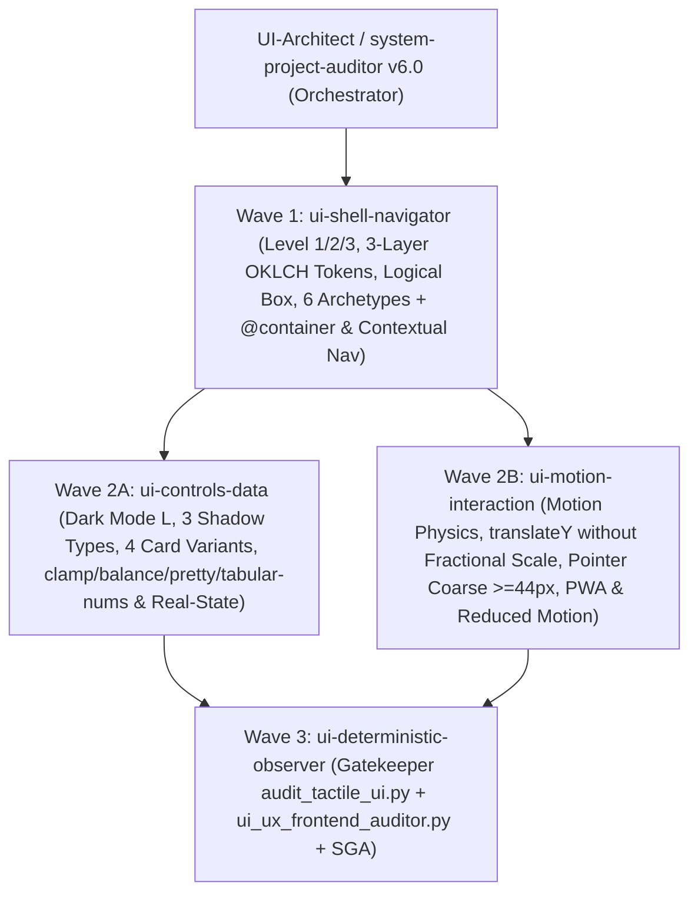

# UI/UX Specialist Subagent Taxonomy & 9-Axis Mapping (`3+1 Topology` — `v6.0.0`)

Maps the **9 Axes + Complexity Matrix** from the SSOT ([`../../../rules/frontend-9-axes-guidelines.md`](../../../rules/frontend-9-axes-guidelines.md)) onto the **Lean 3+1 Topology** (`ui-shell-navigator`, `ui-controls-data`, `ui-motion-interaction`, and `ui-deterministic-observer`) coordinated by **`UI-Architect`** and **`system-project-auditor`**.

---

## 1. Consolidation of the 9 Axes in the 3+1 Topology

| Canonical Agent (`agents/`) | Wave | Absorbed Axes | Architectural Ownership |
| :--- | :---: | :--- | :--- |
| **`ui-shell-navigator`** | Wave 1 | **Axes 1, 4, 6, 8 & 9** (Logical Box, Primitive/Semantic Spacing, Macro/Microlayout Grid/Flex/Subgrid, Adaptive Nav & 3 Complexity Levels) | Selects **Complexity Level (1: `@layer`, 2: Feature-Driven SPA, 3: App Router/PWA)**, 3-layer tokens (`OKLCH`, `light-dark()`, `color-mix()`, RCS) + **Primitive (`--space-1..16`) & Google Stitch Semantic Spacing Tokens (`--space-card-padding`, `--space-grid-gap`, `--space-section-inset`)**, logical Box Model (`inline-size`, `padding-inline`, `display: flow-root`, `gap`), **Flexbox (`flex-wrap: balance`, `safe center`, `min-inline-size: 0`) vs. CSS Grid `RAM` + `subgrid`**, **6 Spatial Archetypes** + `@container`, and **Single-DOM Adaptive Navigation** (*Bottom Nav* with `env(safe-area-inset-bottom)` $< 48\text{em}$ $\leftrightarrow$ *Sidebar Rail* `240px` `100dvh` $\ge 48\text{em}$, intrinsic Popover via `ResizeObserver`, *Breadcrumbs* `<ol role="list">` + silent `::before` + `aria-current="page"` $\ge 3:1$, DOM Order = Visual Order). |
| **`ui-controls-data`** | Wave 2A | **Axes 2, 3, 5 & 7** (4-Pillar Visual Hierarchy, Fluid Typography, Dark Mode $L$, 3 Shadow Types, `<article>` 4-Region Cards & Real-State) | Progressive Dark Mode lightness ($L = 0.16 \to 0.22 \to 0.27$), **3 shadow types** (`box-shadow` Umbra + negative-spread Penumbra + Catch-Light `inset 0 1px 0 0`, `text-shadow`, `filter: drop-shadow()`), `feColorMatrix`, `isolation: isolate`, **4 Card Variants** in `<article>` with 4 regions (`subgrid`, `:has(> img)`, clickable `a.card-link::after` stretch, choice `:has(> :checked)`, Concentric Radii $R_{\text{in}} = \max(4\text{px}, R_{\text{out}} - P)$), `clamp()` scale ($\max \le 2.5\times \min$), `60ch–65ch`, `text-wrap: balance/pretty`, `antialiased` + `font-synthesis: none` + `tabular-nums`, zero emojis, and **Real-State Engineering** (4 FSM states, zero placebos). |
| **`ui-motion-interaction`** | Wave 2B | **Axes 6.2, 7.2 & 8.2** (Blur-Free Motion Physics, Fitts's Law 48x48px, View Transitions, INP & Reduced Motion) | Easing curves `cubic-bezier(0.22, 1, 0.36, 1)` and `cubic-bezier(0.4, 0, 0.2, 1)`, tactile feedback (`translateY(-2px)` on `:hover`, `scale(0.98)` or `translateY(0px)` on `:active`, zero fractional `scale()` on text), `transition-behavior: allow-discrete` declared separately after `transition`, `@starting-style`, View Transitions API, Predictive Back (`scale(0.90)`), `:focus-visible`, `@media (prefers-reduced-motion: no-preference | reduce)`, `@media (any-pointer: coarse)` ($\ge 48\times 48\text{px}$, `gap >= 8px`, `touch-action: manipulation`), `content-visibility: auto` (low INP), and `@media (display-mode: standalone)` (`user-select: none`). |
| **`ui-deterministic-observer`** | Wave 3 | **Deterministic Gatekeeper** (`frontend-testing-auditor` v5.0 + `frontend-ui-ux-auditor` v3.1 + `system-project-auditor` v6.0) | Runs `scripts/audit_tactile_ui.py`, `scripts/ui_ux_frontend_auditor.py`, and `scripts/deterministic_scorer.py`, enforcing `AUDIT-A11Y-01/02`, `AUDIT-VIS-01`, `AUDIT-VIS-EMOJI`, `AUDIT-VIS-BLOAT`, `AUDIT-STATE-01`, `AUDIT-SEC-01`, and `SGA` ($\ge 90.0$). |

---

## 2. Execution Topology (`plans/ui_composition_dag.json`)

